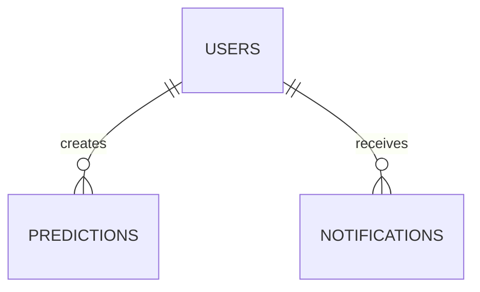

# GreenGuard Database Specification

Version: 2.0

Project: GreenGuard

Database: PostgreSQL

ORM: Django ORM

---

# 1. Overview

## 1.1 Purpose

This document defines the complete database architecture of the GreenGuard system.

It serves as the official database reference for frontend developers, backend developers, AI engineers, and future contributors.

The document specifies:

• Database architecture

• Database tables

• Relationships

• Constraints

• Indexes

• Naming conventions

• Entity relationships

• Data integrity rules

• ORM mapping

• Future scalability

---

# 1.2 Database Technology

Database Management System

PostgreSQL

ORM

Django ORM

Primary Language

SQL

Character Encoding

UTF-8

---

# 1.3 Database Goals

The database has been designed to achieve the following objectives.

• Secure data storage

• Efficient querying

• High scalability

• High availability

• Data consistency

• Easy maintenance

• Modular architecture

• AI compatibility

• REST API compatibility

---

# 1.4 Database Responsibilities

The GreenGuard database stores:

• User Accounts

• Authentication Information

• Prediction History

• Uploaded Plant Images

• AI Prediction Reports

• Notifications

• Dashboard Information

The database does NOT store:

• AI Models

• Neural Network Weights

• Temporary AI Processing Data

Those remain inside the AI services.

---

# 1.5 Database Architecture

Frontend

↓

Django Backend

↓

Django ORM

↓

PostgreSQL

Only the Django Backend communicates with PostgreSQL.

Neither the frontend nor the AI modules communicate directly with the database.

---

# 1.6 Database Naming

Database Name

greenguard_db

Schema

public

---

# 1.7 Design Principles

The database follows:

• Third Normal Form (3NF)

• Minimal Data Redundancy

• High Data Integrity

• Proper Foreign Keys

• Clear Relationships

• Easy Expansion

• ORM Compatibility

---

# 1.8 Main Tables

The first version of GreenGuard contains the following primary tables.

1. users

2. predictions

3. notifications

Future versions may introduce additional tables without changing the existing schema.

---

# 1.9 Relationship Overview

Users
   ↓
Farms
   ↓
Predictions

Users
   ↓
Notifications

Each prediction belongs to exactly one user.

Each notification belongs to exactly one user.

---

# 1.10 Future Expansion

The database has been intentionally designed to allow future modules including:

• IoT Sensor Data

• Farm Management

• Crop Calendar

• Yield Prediction

• Fertilizer Recommendation

• Smart Irrigation

• Drone Imagery

• Satellite Monitoring

without requiring major architectural changes.

# 2. Database Design Standards

## 2.1 Overview

The GreenGuard database follows standardized design principles to ensure consistency, maintainability, security, and scalability.

All database tables, columns, relationships, and constraints must follow these standards.

---

# 2.2 Naming Conventions

The following naming conventions shall be used throughout the database.

## Database

greenguard_db

---

## Tables

Table names shall:

• Use lowercase letters

• Use snake_case

• Be plural nouns

Examples

users

predictions

notifications

---

## Columns

Column names shall:

• Use lowercase letters

• Use snake_case

• Be descriptive

Examples

first_name

last_name

profile_image

prediction_date

created_at

updated_at

---

## Primary Keys

Every table shall have one primary key.

Naming Convention

id

Example

id UUID PRIMARY KEY

---

## Foreign Keys

Foreign key names should end with "_id".

Examples

user_id

prediction_id

---

## Boolean Columns

Boolean fields should clearly indicate a true/false condition.

Examples

is_active

is_verified

is_deleted

is_read

---

# 2.3 Primary Keys

Each table shall contain a unique primary key.

Recommended Type

UUID

Advantages

• Globally unique

• Difficult to guess

• Better security

• Easier future distributed deployment

Example

id

UUID

PRIMARY KEY

---

# 2.4 Foreign Keys

Relationships between tables shall be enforced using foreign keys.

Example

Prediction

↓

User

Relationship

Many-to-One

Notification

↓

User

Relationship

Many-to-One

---

# 2.5 Timestamp Fields

Every table should include timestamp fields.

Standard Fields

created_at

updated_at

Purpose

• Record creation time

• Record modification time

Both fields shall be automatically managed by Django.

---

# 2.6 Audit Fields

Where appropriate, tables may include audit-related fields.

Examples

created_by

updated_by

These fields improve traceability in administrative features.

---

# 2.7 Required Fields

Important business fields shall not allow NULL values.

Examples

Email

Password

Prediction Date

Diagnosis

Recommendation

Only optional information may be nullable.

---

# 2.8 Unique Constraints

Unique constraints shall be applied where necessary.

Examples

User Email

Username (if implemented)

These constraints prevent duplicate records.

---

# 2.9 Indexing Strategy

Indexes should be created on fields that are frequently searched or filtered.

Recommended indexed fields include:

• email

• created_at

• prediction_date

• user_id

Proper indexing improves query performance as the system grows.

---

# 2.10 Data Types

The following PostgreSQL data types are recommended.

UUID

Primary Keys

VARCHAR

Names

TEXT

Long Descriptions

BOOLEAN

True/False Values

TIMESTAMP

Date and Time

FLOAT

Confidence Scores

JSONB

Future Flexible Metadata (if required)

---

# 2.11 Default Values

Default values should be used where appropriate.

Examples

is_active

TRUE

created_at

Current Timestamp

updated_at

Current Timestamp

Defaults help maintain data consistency.

---

# 2.12 Data Integrity

The database shall enforce:

• Primary Keys

• Foreign Keys

• Unique Constraints

• NOT NULL Constraints

• Valid Relationships

These mechanisms ensure reliable and consistent data.

---

# 2.13 Cascade Rules

Relationships shall define appropriate deletion behavior.

Recommended Strategy

User

↓

Predictions

ON DELETE CASCADE

User

↓

Notifications

ON DELETE CASCADE

This prevents orphaned records when a user is removed.

---

# 2.14 Soft Delete Strategy

GreenGuard Version 1 does not implement soft deletion.

Records removed by users or administrators are permanently deleted.

Future versions may introduce soft delete functionality using:

is_deleted

deleted_at

---

# 2.15 Security Considerations

Database security includes:

• Strong Authentication

• Restricted Database Access

• ORM-Based Queries

• No Hardcoded Credentials

• Environment Variable Configuration

Only the Django Backend may access PostgreSQL directly.

---

# 2.16 ORM Compatibility

All database tables shall be represented by Django Models.

Database operations shall use Django ORM.

Raw SQL should only be used for exceptional cases where ORM cannot satisfy performance or functionality requirements.

---

# 2.17 Performance Guidelines

To maintain good performance:

• Normalize data.

• Avoid duplicated information.

• Create indexes where appropriate.

• Keep relationships simple.

• Optimize query execution.

• Retrieve only required fields.

---

# 2.18 Database Standards Summary

All database objects in GreenGuard shall follow these standards to ensure:

• Consistency

• Maintainability

• Scalability

• Security

• Performance

• Future Expandability

These standards apply to every table created in the GreenGuard database.
# 3. Entity Relationship Diagram (ERD)

## 3.1 Overview

The GreenGuard database follows a relational database model implemented using PostgreSQL.

The database has been designed to maintain data integrity, minimize redundancy, and support future expansion.

In Version 1 of GreenGuard, three primary business entities are used:

• Users

• Predictions

• Notifications

Each entity has a clearly defined responsibility and relationships are maintained through foreign keys.

---

# 3.2 Database Entities

The primary entities are:

## Users

Stores user account information and authentication details.

---

## Predictions

Stores prediction reports generated by the AI system.

Each prediction belongs to one user.

---

## Notifications

Stores notifications generated for users.

Each notification belongs to one user.

---

# 3.3 Entity Relationships

The GreenGuard database currently contains the following relationships.

Relationship 1

Users

↓

Predictions

Relationship Type

One-to-Many

Meaning

One user can have many prediction reports.

Each prediction belongs to exactly one user.

---

Relationship 2

Users

↓

Notifications

Relationship Type

One-to-Many

Meaning

One user can receive many notifications.

Each notification belongs to exactly one user.

---

# 3.4 High-Level ER Diagram

---

# 3.5 Relationship Explanation

## Users → Predictions

Cardinality

One-to-Many

Business Rule

A registered user may analyze multiple plant images over time.

Each analysis generates one prediction report.

Therefore:

One User

↓

Many Predictions

Each prediction cannot exist without an associated user.

---

## Users → Notifications

Cardinality

One-to-Many

Business Rule

The system may generate multiple notifications for the same user.

Examples include:

• Prediction completed

• Weather alert

• System announcement

Each notification belongs to exactly one user.

---

# 3.6 Relationship Matrix

| Parent Entity | Child Entity | Relationship |
|---------------|--------------|--------------|
| Users | Predictions | One-to-Many |
| Users | Notifications | One-to-Many |

---

# 3.7 Foreign Key Mapping

| Child Table | Foreign Key | References |
|-------------|-------------|------------|
| predictions | user_id | users.id |
| notifications | user_id | users.id |

---

# 3.8 Data Flow

Prediction Workflow

User

↓

Uploads Plant Image

↓

Prediction Request

↓

AI Analysis

↓

Prediction Report

↓

Prediction Saved

↓

Displayed in History

---

Notification Workflow

Prediction Generated

↓

Backend Creates Notification

↓

Notification Saved

↓

Displayed to User

---

# 3.9 Integrity Rules

The database enforces the following rules:

• Every prediction must reference a valid user.

• Every notification must reference a valid user.

• Users may exist without predictions.

• Users may exist without notifications.

• Predictions cannot exist without users.

• Notifications cannot exist without users.

---

# 3.10 Future Expandability

The current ERD has been intentionally designed for future expansion.

Additional entities may include:

• Farms

• Fields

• Sensor Data

• Crop Calendar

• Fertilizer Recommendations

• Irrigation Plans

• Yield Predictions

• Drone Images

• Satellite Images

These entities can be integrated through new foreign key relationships without modifying the existing schema.

---

# 3.11 ERD Summary

The GreenGuard Version 1 database maintains a simple and maintainable relational structure.

Advantages include:

• Clear ownership of prediction records.

• Simplified notification management.

• Strong referential integrity.

• Easy ORM implementation.

• Scalable architecture for future modules.

This ERD serves as the foundation for all database tables described in the following sections.
# 4. Users Table

## 4.1 Overview

The **users** table stores all registered user accounts for the GreenGuard system.

It is responsible for authentication, profile management, and ownership of prediction reports and notifications.

Each registered user has a unique account and can access only their own prediction history and notifications.

---

# 4.2 Table Name

users

---

# 4.3 Purpose

The users table stores:

• User authentication information

• Personal profile information

• Account status

• User role

• Account timestamps

---

# 4.4 Primary Key

Primary Key

id

Type

UUID

Characteristics

• Unique

• Auto Generated

• Immutable

---

# 4.5 Columns

| Column | Data Type | Required | Default | Description |
|----------|-----------|----------|----------|-------------|
| id | UUID | Yes | Auto Generated | Primary Key |
| first_name | VARCHAR(100) | Yes | — | User first name |
| last_name | VARCHAR(100) | Yes | — | User last name |
| email | VARCHAR(255) | Yes | Unique | User email address |
| password | VARCHAR(255) | Yes | — | Hashed password |
| profile_image | TEXT | No | NULL | Profile image path or URL |
| role | VARCHAR(20) | Yes | farmer | User role |
| is_active | BOOLEAN | Yes | TRUE | Account status |
| is_verified | BOOLEAN | Yes | FALSE | Email verification status |
| created_at | TIMESTAMP | Yes | Current Timestamp | Account creation time |
| updated_at | TIMESTAMP | Yes | Current Timestamp | Last update time |

---

# 4.6 Column Descriptions

## id

Unique identifier for every user.

Generated automatically.

Used as the primary key.

---

## first_name

Stores the user's first name.

Maximum length

100 characters.

---

## last_name

Stores the user's last name.

Maximum length

100 characters.

---

## email

Stores the user's email address.

Rules

• Required

• Unique

• Valid email format

This field is used during login.

---

## password

Stores the encrypted password.

Passwords must never be stored in plain text.

Django's password hashing mechanism shall be used.

---

## profile_image

Stores the path or URL of the user's profile picture.

Optional field.

---

## role

Defines the user role.

Supported values

• farmer

• admin

Default

farmer

---

## is_active

Determines whether the account is active.

Default

TRUE

Inactive users cannot log in.

---

## is_verified

Indicates whether the user's email has been verified.

Default

FALSE

---

## created_at

Automatically stores the account creation date and time.

---

## updated_at

Automatically stores the last modification date and time.

---

# 4.7 Constraints

Primary Key

id

Unique Constraint

email

Not Null

• first_name

• last_name

• email

• password

• role

• is_active

• is_verified

• created_at

• updated_at

---

# 4.8 Indexes

Indexes should be created on:

• email

• created_at

These indexes improve authentication and search performance.

---

# 4.9 Relationships

Relationship

Users

↓

Predictions

Type

One-to-Many

A single user may own multiple prediction reports.

---

Relationship

Users

↓

Notifications

Type

One-to-Many

A single user may receive multiple notifications.

---

# 4.10 Validation Rules

Email

• Required

• Unique

• Valid email format

Password

• Required

• Stored as hashed value

Role

Allowed values

• farmer

• admin

---

# 4.11 Django Model Mapping

Model Name

User

Primary Key

UUIDField

Authentication

Custom Django User Model

Authentication Method

Email-based authentication

---

# 4.12 API Usage

The users table is accessed through:

Authentication APIs

• Register

• Login

• Logout

• Refresh Token

User APIs

• Profile

• Update Profile

• Change Password

• Delete Account

---

# 4.13 Security Considerations

The users table shall enforce:

• Password hashing

• Unique email addresses

• JWT-based authentication

• Role-based authorization

• Restricted access to user records

Sensitive information such as passwords must never be returned in API responses.

---

# 4.14 Table Summary

The users table is the central identity management component of GreenGuard.

It provides secure authentication, user profile management, and ownership of prediction reports and notifications while maintaining compatibility with Django's authentication framework.
# 5. Farms Table

## 5.1 Overview

Stores information about farms owned by registered users.

Each farm belongs to exactly one user.

The table stores the farm's geographical coordinates, which are used by the Weather Module to retrieve weather information.

A single user may own multiple farms.

---

## Table Name

farms

---

## Columns

| Column | Type | Description |
|---------|------|-------------|
| id | UUID | Primary Key |
| user_id | UUID | References Users(id) |
| farm_name | VARCHAR(100) | Farm name |
| address | TEXT | Farm address |
| latitude | DECIMAL(10,8) | GPS latitude |
| longitude | DECIMAL(11,8) | GPS longitude |
| created_at | TIMESTAMP | Creation time |
| updated_at | TIMESTAMP | Last modification |

---

## Primary Key

id

---

## Foreign Key

user_id → users.id

---

## Relationship

One User

↓

Many Farms
# 6. Predictions Table

## 6.1 Overview

The **predictions** table stores every prediction generated by the GreenGuard system.

Each prediction represents one complete plant health analysis initiated by a user.

A prediction contains:

• Uploaded plant image

• The independent results of Module 1 (Disease Detection), Module 2 (Soil & Nutrient Health) and Module 3 (Weather Risk) — together, the Module 4 Integrated Analysis Report

• Prediction metadata

There is no combined "final diagnosis": GreenGuard has no Fusion model, so each module's result is stored and shown on its own.

Each prediction belongs to exactly one user and one farm.

This allows users to maintain separate prediction histories for multiple farms while enabling accurate weather analysis, environmental monitoring, and farm-specific analytics.
---

# 6.2 Table Name

predictions

---
# 6.3 Purpose

The predictions table stores:

• Prediction ownership

• Associated farm

• Uploaded image information

• Final AI report

• Prediction timestamp

• Prediction status

• Confidence score

• Recommendation summary

Each prediction is associated with a specific farm, enabling farm-level prediction history, weather integration, and future analytics.

---

# 6.4 Primary Key

Primary Key

id

Type

UUID

Auto Generated

Yes

---

# 6.5 Foreign Keys

## Foreign Key 1

Column

user_id

References

users.id

Relationship

Many Predictions

↓

One User

---

## Foreign Key 2

Column

farm_id

References

farms.id

Relationship

Many Predictions

↓

One Farm

---

## Foreign Key 3

Column

module2_analysis_id

References

module2_analyses.id

Nullable

Yes — null when the farm had no Module 2 Analysis at prediction time

Relationship

Many Predictions

↓

One Module 2 Analysis (optional)

---

# 6.6 Columns

| Column | Data Type | Required | Default | Description |
|----------|-----------|----------|----------|-------------|
| id | UUID | Yes | Auto Generated | Primary Key |
| user_id | UUID | Yes | — | Owner of prediction |
| farm_id | UUID | Yes | — | Associated farm |
| module2_analysis_id | UUID | No | NULL | Exact Module 2 Analysis included in this report, if any |
| uploaded_image | TEXT | Yes | — | Uploaded plant image path |
| final_diagnosis | VARCHAR(255) | No | NULL | Legacy (retired ANN Fusion) — always NULL for new analyses |
| confidence_score | FLOAT | No | NULL | Legacy (retired ANN Fusion) — always NULL for new analyses |
| prediction_report | JSONB | Yes | — | Module 1, 2 and 3 results (`module1` / `module2` / `module3`) |
| recommendation_summary | TEXT | No | NULL | Legacy (retired ANN Fusion) — always NULL for new analyses |
| prediction_status | VARCHAR(30) | Yes | completed | Prediction status |
| created_at | TIMESTAMP | Yes | Current Timestamp | Prediction creation time |
| updated_at | TIMESTAMP | Yes | Current Timestamp | Last update time |

---

# 6.7 Column Descriptions

## id

Unique identifier for every prediction.

Automatically generated.

---

## user_id

References the owner of the prediction.

Foreign Key

users.id

---
## farm_id

References the farm where the prediction was generated.

Foreign Key

farms.id

This field enables:

- Farm-specific prediction history
- Weather integration
- Dashboard analytics per farm
- Environmental monitoring

---

## module2_analysis_id

References the exact Module 2 Analysis whose result was included in this report (the farm's latest one at scan time).

Foreign Key

module2_analyses.id

Nullable — null when the farm had no Module 2 Analysis recorded yet at prediction time. `SET NULL` if the referenced row is ever deleted, so an existing Prediction is never invalidated by that.

## uploaded_image

Stores the path or URL of the uploaded plant image.

Example

media/uploads/plant_leaf_001.jpg

---

## final_diagnosis

Legacy column. It held the diagnosis produced by the retired ANN Fusion design. No current module produces a combined diagnosis, so it is NULL for every new analysis; it is kept (nullable, migration `predictions/0003`) only so older records stay readable. The disease result lives in `prediction_report.module1`.

---

## confidence_score

Legacy column, NULL for every new analysis — see `final_diagnosis`. Module 1's own confidence lives in `prediction_report.module1.prediction.confidence`.

---

## prediction_report

Stores the Integrated Analysis Report (Module 4): each AI module's result, unmodified.

The JSON structure must exactly follow the format defined in:

REST_API_SPEC.md

Module 4

This field includes:

• `module1` — Disease Detection output (live Module 1 contract, including the `status: "uncertain"` case)

• `module2` — the farm's latest Soil & Nutrient Health output, or null

• `module3` — Weather Risk output

Records created before 2026-10-03 may also contain a `module4` key from the retired ANN Fusion design; they are left untouched.

Using JSONB allows future AI modules to be added without changing the database schema.

---

## recommendation_summary

Legacy column, NULL for every new analysis — see `final_diagnosis`. No current module produces a cross-module recommendation list; Module 2's own recommendation notes are part of `prediction_report.module2`.

---

## prediction_status

Possible values

• pending

• processing

• completed

• failed

Default

completed

---

## created_at

Stores prediction creation timestamp.

Automatically generated.

---

## updated_at

Stores the last modification timestamp.

Automatically updated.

---

# 6.8 Constraints

Primary Key

id

Foreign Keys

user_id → users.id

farm_id → farms.id

module2_analysis_id → module2_analyses.id (nullable)

Not Null

• user_id

• farm_id

• uploaded_image

• prediction_report

• prediction_status

• created_at

• updated_at

Nullable

• module2_analysis_id

• final_diagnosis (legacy)

• confidence_score (legacy)

• recommendation_summary (legacy)

---

# 6.9 Indexes

Indexes should be created on:

• user_id

• farm_id

• created_at

• prediction_status

• module2_analysis_id

These indexes improve dashboard queries, prediction history retrieval, and farm-level analytics.

---

# 6.10 Relationships

Users

↓

Farms

↓

Predictions

Relationships

One User

↓

Many Farms

One Farm

↓

Many Predictions

One Module 2 Analysis (optional)

↓

Many Predictions (in practice, the ones created while it was the farm's latest run)

Each prediction belongs to exactly one farm and one user, and optionally references one Module 2 Analysis.

---

# 6.11 Prediction Lifecycle

User Selects Farm

↓

User Uploads Image

↓

Backend Validates Request

↓

Image Saved

↓

AI Modules Execute

↓

Weather Retrieved Using Farm Coordinates

↓

Module 1 (Disease), Module 2 (latest Soil & Nutrient result) and Module 3 (Weather) Results Stored Together — Module 4 Integrated Analysis Report

↓

Prediction Saved

↓

Displayed in Farm Dashboard & Prediction History

---

# 6.12 API Usage

The predictions table is accessed through:

Prediction APIs

• Analyze Plant

• Prediction History

• Prediction Details

• Delete Prediction

Dashboard APIs

• Recent Predictions

• Dashboard Statistics

---

# 6.13 Data Integrity Rules

The system shall ensure:

• Every prediction belongs to an existing user.

• Uploaded image paths remain valid.

• Prediction reports follow the standardized JSON contract.

• Confidence scores remain within valid ranges.

• Prediction status uses only supported values.
• Every prediction belongs to an existing farm.
---

# 6.14 Django Model Mapping

Model Name

Prediction

Primary Key

UUIDField

Foreign Keys

User

Farm

Module2Analysis (nullable)

JSON Field

prediction_report

Image Path

ImageField or CharField (depending on storage strategy)

---

# 6.15 Security Considerations

Prediction reports are private.

Only the prediction owner and administrators may access them.

Prediction records must not be accessible by other users.

Uploaded image paths should never expose sensitive server directories.

---

# 6.16 Table Summary

The predictions table is the core business table of the GreenGuard system.

Each prediction is linked to both a user and a specific farm, ensuring that AI analyses, weather information, environmental conditions, and prediction history remain organized on a per-farm basis.

The table stores the complete AI prediction report, preserves the standardized JSON contract defined in the REST_API_SPEC.md, and provides the foundation for dashboard analytics, prediction history, weather integration, and future AI enhancements.

# 6A. Module 2 Analyses Table

## 6A.1 Overview

Stores every Soil & Nutrient Health Check (Module 2) run for a farm.

Module 2 is a standalone feature — a farmer can run a check without ever creating a Prediction, and a Prediction can be created without a Module 2 check ever having been run for that farm.

Each run creates exactly one row. Rows are never updated after creation — this table is append-only, so a Prediction that references a specific row is guaranteed a stable, reproducible snapshot even if the farmer runs Module 2 again later.

---

## 6A.2 Table Name

module2_analyses

---

## 6A.3 Purpose

The module2_analyses table stores:

• The farm the check was run for

• Whether the farmer's selected crop was supported by the model

• The exact validated request sent to the Module 2 Orchestrator

• The exact response returned by the Module 2 Orchestrator

• The timestamp of the run

This preserves a complete, ordered history of every Module 2 run per farm, and lets the Quick Scan report (Module 4) include the most recent run for a farm — or any past run, via a Prediction's stored reference — without re-invoking Module 2.

---

## 6A.4 Primary Key

Primary Key

id

Type

UUID

Auto Generated

Yes

---

## 6A.5 Foreign Key

Foreign Key

farm_id

References

farms.id

Relationship

Many Module 2 Analyses

↓

One Farm

---

## 6A.6 Columns

| Column | Data Type | Required | Default | Description |
|----------|-----------|----------|----------|-------------|
| id | UUID | Yes | Auto Generated | Primary Key |
| farm_id | UUID | Yes | — | Farm this check was run for |
| crop_supported | BOOLEAN | Yes | — | Whether the selected crop was model-supported for this run |
| request_payload | JSONB | Yes | — | Exact validated Module 2 request, per REST_API_SPEC.md Section 8A |
| response_payload | JSONB | Yes | — | Exact Module 2 response, per REST_API_SPEC.md Section 8A, stored unmodified |
| created_at | TIMESTAMP | Yes | Current Timestamp | Run timestamp |

There is no updated_at column — rows are append-only and never modified after creation.

---

## 6A.7 Column Descriptions

## id

Unique identifier for every Module 2 run.

Automatically generated.

---

## farm_id

References the farm this check was run for.

Foreign Key

farms.id

---

## crop_supported

Denormalized from response_payload.crop_supported, so unsupported-crop runs can be filtered without inspecting the JSON body.

---

## request_payload

Stores the exact validated request data structure sent to the Module 2 Orchestrator, without modifying its fields or values, per REST_API_SPEC.md Section 8A.

---

## response_payload

Stores the exact response data structure returned by Module 2, without modifying its fields or values, per REST_API_SPEC.md Section 8A — identical to what was returned to the frontend at the time. This is the field copied into a Quick Scan report's `prediction_report.module2`.

---

## created_at

Stores the run timestamp. Automatically generated. Ordering by this column (descending) gives the latest run for a farm — there is no separate "latest result" column to keep in sync.

---

## 6A.8 Constraints

Primary Key

id

Foreign Key

farm_id → farms.id

Not Null

• farm_id

• crop_supported

• request_payload

• response_payload

• created_at

---

## 6A.9 Indexes

Indexes should be created on:

• farm_id

• created_at (composite with farm_id)

This composite index supports retrieving the latest run for a farm efficiently.

---

## 6A.10 Relationships

Farms

↓

Module 2 Analyses

↓ (optional, via Predictions.module2_analysis_id)

Predictions

One Farm may have many Module 2 Analyses. One Module 2 Analysis may be referenced by zero or more Predictions.

---

## 6A.11 Data Integrity Rules

The system shall ensure:

• Every Module 2 Analysis belongs to an existing farm.

• request_payload and response_payload are stored exactly as validated/returned — never transformed.

• Rows are never updated after creation (append-only).

• Both supported and unsupported crop runs are persisted identically — there is no special case for either.

---

## 6A.12 Django Model Mapping

Model Name

Module2Analysis

Primary Key

UUIDField

Foreign Key

Farm

JSON Fields

request_payload, response_payload

---

## 6A.13 Table Summary

The module2_analyses table gives every Module 2 run a permanent, immutable record, independent of the image-based Prediction workflow. This is what lets the Quick Scan report (Module 4) include a farm's Module 2 result without Module 2 ever being invoked as part of the `/api/v1/predictions/analyze/` chain, and lets a Prediction's reference to a specific run remain reproducible even after the farmer runs Module 2 again.

# 6. Notifications Table

## 6.1 Overview

The **notifications** table stores notifications generated by the GreenGuard system.

Notifications keep users informed about important events such as completed predictions, weather alerts, system announcements, and future application updates.

Each notification belongs to exactly one user.

---

# 6.2 Table Name

notifications

---

# 6.3 Purpose

The notifications table stores:

• User notifications

• Notification title

• Notification message

• Notification type

• Read status

• Notification timestamps

---

# 6.4 Primary Key

Primary Key

id

Type

UUID

Auto Generated

Yes

---

# 6.5 Foreign Key

Foreign Key

user_id

References

users.id

Relationship

Many Notifications

↓

One User

---

# 6.6 Columns

| Column | Data Type | Required | Default | Description |
|----------|-----------|----------|----------|-------------|
| id | UUID | Yes | Auto Generated | Primary Key |
| user_id | UUID | Yes | — | Notification owner |
| title | VARCHAR(255) | Yes | — | Notification title |
| message | TEXT | Yes | — | Notification message |
| notification_type | VARCHAR(50) | Yes | system | Notification category |
| is_read | BOOLEAN | Yes | FALSE | Read status |
| created_at | TIMESTAMP | Yes | Current Timestamp | Notification creation time |
| updated_at | TIMESTAMP | Yes | Current Timestamp | Last update time |

---

# 6.7 Column Descriptions

## id

Unique identifier for every notification.

Automatically generated.

---

## user_id

References the user who receives the notification.

Foreign Key

users.id

---

## title

Short title displayed in the notification list.

Example

Prediction Completed

Weather Alert

System Maintenance

---

## message

Stores the complete notification message.

Example

Your plant analysis has been completed successfully.

---

## notification_type

Defines the notification category.

Supported values

• system

• prediction

• weather

Default

system

Future versions may introduce additional notification types.

---

## is_read

Indicates whether the notification has been viewed by the user.

Default

FALSE

When the user opens the notification, this value becomes TRUE.

---

## created_at

Stores the creation timestamp.

Automatically generated.

---

## updated_at

Stores the last modification timestamp.

Automatically updated.

---

# 6.8 Constraints

Primary Key

id

Foreign Key

user_id

Not Null

• user_id

• title

• message

• notification_type

• is_read

• created_at

• updated_at

---

# 6.9 Indexes

Indexes should be created on:

• user_id

• is_read

• created_at

These indexes improve notification retrieval and unread notification queries.

---

# 6.10 Relationships

Users

↓

Notifications

Relationship

One-to-Many

A single user may receive multiple notifications.

Each notification belongs to exactly one user.

---

# 6.11 Notification Lifecycle

System Event

↓

Backend Generates Notification

↓

Notification Saved

↓

Displayed in Notification Center

↓

User Opens Notification

↓

is_read = TRUE

---

# 6.12 API Usage

The notifications table is accessed through:

Notification APIs

• Get Notifications

• Get Unread Notifications

• Mark Notification as Read

• Mark All Notifications as Read

• Delete Notification

---

# 6.13 Data Integrity Rules

The system shall ensure:

• Every notification belongs to an existing user.

• Notification titles are not empty.

• Notification messages are not empty.

• Only supported notification types are stored.

• Read status remains boolean.

---

# 6.14 Django Model Mapping

Model Name

Notification

Primary Key

UUIDField

Foreign Key

User

Boolean Field

is_read

---

# 6.15 Security Considerations

Notifications are private.

Only the notification owner and administrators may access them.

Users must never view notifications belonging to another account.

---

# 6.16 Table Summary

The notifications table provides a centralized mechanism for delivering system updates, prediction alerts, and weather notifications to users.

It supports efficient notification management while maintaining strong user-level data isolation and compatibility with the GreenGuard REST API.

# 7. Database Relationships & Django ORM Mapping

## 7.1 Overview

The GreenGuard database follows a relational model where entities are connected using foreign key relationships.

Version 1 of GreenGuard contains three primary entities:

• Users

• Predictions

• Notifications

All relationships are implemented using Django ORM and PostgreSQL foreign key constraints.

---

# 7.2 Relationship Diagram

Users

│

├──────────────► Predictions

│

└──────────────► Notifications

Both relationships are:

One-to-Many

---

# 7.3 Relationship Summary

| Parent Table | Child Table | Relationship | Foreign Key |
|--------------|------------|--------------|-------------|
| users | predictions | One-to-Many | user_id |
| users | notifications | One-to-Many | user_id |

---

# 7.4 Users → Predictions

Relationship

One User

↓

Many Predictions

Explanation

A registered user can perform multiple plant analyses.

Each analysis generates one prediction report.

Every prediction must belong to exactly one user.

---

## Foreign Key

predictions.user_id

↓

users.id

---

## Django ORM

ForeignKey

Model

User

related_name

predictions

on_delete

CASCADE

---

## Reverse Access

User

↓

Predictions

Example

user.predictions.all()

---

# 7.5 Users → Notifications

Relationship

One User

↓

Many Notifications

Explanation

A user may receive multiple notifications.

Each notification belongs to one user.

---

## Foreign Key

notifications.user_id

↓

users.id

---

## Django ORM

ForeignKey

Model

User

related_name

notifications

on_delete

CASCADE

---

## Reverse Access

User

↓

Notifications

Example

user.notifications.all()

---

# 7.6 Cascade Behavior

GreenGuard uses

ON DELETE CASCADE

for all user-owned records.

If a user account is deleted:

↓

Prediction History

↓

Deleted

Notification History

↓

Deleted

This prevents orphaned records.

---

# 7.7 Referential Integrity

The database guarantees:

• A prediction cannot exist without a valid user.

• A notification cannot exist without a valid user.

• Foreign keys always reference existing records.

• Invalid references are rejected.

---

# 7.8 Relationship Rules

Users

Can exist without predictions.

Can exist without notifications.

Predictions

Must always belong to one user.

Notifications

Must always belong to one user.

---

# 7.9 ORM Query Examples

Retrieve all predictions of a user

User

↓

Predictions

user.predictions.all()

---

Retrieve latest prediction

user.predictions.order_by("-created_at").first()

---

Retrieve unread notifications

user.notifications.filter(is_read=False)

---

Retrieve prediction count

user.predictions.count()

---

Retrieve notification count

user.notifications.count()

---

# 7.10 Relationship Best Practices

Developers should:

• Always use Django ORM relationships.

• Avoid manual SQL joins.

• Use select_related() when loading foreign keys.

• Use prefetch_related() for reverse relationships.

• Avoid N+1 query problems.

• Keep relationships simple and normalized.

---

# 7.11 Future Relationships

The current schema is intentionally minimal.

Future versions may introduce:

Users

↓

Farms

↓

Fields

↓

Sensor Data

↓

Crop Calendar

↓

Yield Reports

↓

Irrigation Plans

↓

Fertilizer Plans

↓

Drone Images

↓

Satellite Images

These entities can be integrated without modifying existing relationships.

---

# 7.12 ORM Mapping Summary

| Django Model | Related Model | Relationship | related_name |
|--------------|---------------|--------------|--------------|
| User | Prediction | One-to-Many | predictions |
| User | Notification | One-to-Many | notifications |

---

# 7.13 Relationship Summary

The GreenGuard database currently contains two primary relationships:

Users → Predictions

Users → Notifications

These relationships provide:

• Secure ownership

• Simple querying

• Strong referential integrity

• Efficient ORM implementation

• Easy future scalability

The relational design supports the current GreenGuard architecture while allowing additional modules to be integrated without restructuring the existing database.

# 8. Indexes, Constraints & Database Optimization

## 8.1 Overview

The GreenGuard database is designed to provide efficient query performance while maintaining strong data integrity.

Indexes, constraints, and optimization strategies are applied to ensure fast retrieval of records, prevent invalid data, and support future scalability.

---

# 8.2 Primary Keys

Every table shall contain a UUID primary key.

| Table | Primary Key |
|---------|-------------|
| users | id |
| predictions | id |
| notifications | id |

Primary keys are automatically indexed by PostgreSQL.

---

# 8.3 Foreign Keys

The following foreign key relationships are enforced.

| Child Table | Foreign Key | Parent Table |
|--------------|-------------|--------------|
| predictions | user_id | users |
| notifications | user_id | users |

Foreign keys ensure referential integrity.

---

# 8.4 Unique Constraints

The following fields must remain unique.

| Table | Column |
|---------|--------|
| users | email |

Duplicate email addresses are not allowed.

---

# 8.5 NOT NULL Constraints

Required fields must not allow NULL values.

## Users

• first_name

• last_name

• email

• password

• role

• is_active

• is_verified

• created_at

• updated_at

---

## Predictions

• user_id

• uploaded_image

• prediction_report

• prediction_status

• created_at

• updated_at

---

## Notifications

• user_id

• title

• message

• notification_type

• is_read

• created_at

• updated_at

---

# 8.6 Default Values

The following default values shall be used.

## Users

role

farmer

is_active

TRUE

is_verified

FALSE

created_at

Current Timestamp

updated_at

Current Timestamp

---

## Predictions

prediction_status

completed

created_at

Current Timestamp

updated_at

Current Timestamp

---

## Notifications

notification_type

system

is_read

FALSE

created_at

Current Timestamp

updated_at

Current Timestamp

---

# 8.7 Index Strategy

Indexes shall be created on fields frequently used in filtering, sorting, or searching.

---

## Users

Indexes

• email

• created_at

---

## Predictions

Indexes

• user_id

• prediction_status

• created_at

---

## Notifications

Indexes

• user_id

• is_read

• created_at

---

# 8.8 Composite Indexes

Version 1 of GreenGuard does not require composite indexes.

If future performance analysis identifies slow queries, composite indexes may be introduced.

Examples

(user_id, created_at)

(user_id, prediction_status)

(user_id, is_read)

---

# 8.9 Query Optimization

Developers should follow these practices.

• Retrieve only required fields.

• Avoid unnecessary joins.

• Use database indexes.

• Use Django ORM efficiently.

• Avoid duplicate queries.

• Use pagination for large datasets.

---

# 8.10 ORM Optimization

Recommended Django ORM methods include:

select_related()

For foreign key relationships.

prefetch_related()

For reverse relationships.

only()

To retrieve only required columns.

defer()

To postpone loading large fields.

---

# 8.11 Prediction Report Storage

The complete AI prediction output is stored in:

prediction_report (JSONB)

Advantages

• Flexible structure

• Future-proof

• Supports additional AI modules

• No schema changes required

Only commonly queried fields such as:

• prediction_status

are stored separately. List views read Module 1's disease result directly from `prediction_report.module1.prediction` (PostgreSQL JSONB key lookups).

---

# 8.12 Database Performance Guidelines

To maintain performance, developers should:

• Keep database normalized.

• Avoid redundant data.

• Create indexes on searchable fields.

• Optimize ORM queries.

• Monitor slow queries.

• Archive old records if necessary.

---

# 8.13 Data Integrity

The database shall enforce:

• Primary Keys

• Foreign Keys

• Unique Constraints

• NOT NULL Constraints

• Valid Relationships

These rules ensure that invalid or orphaned records cannot be created.

---

# 8.14 Scalability Considerations

The database has been designed to support future growth.

Potential optimizations include:

• Additional indexes

• Read replicas

• Query caching

• Partitioning large tables

• Cloud-managed PostgreSQL services

These enhancements can be introduced without redesigning the current schema.

---

# 8.15 Optimization Summary

The GreenGuard database applies indexing, constraints, and ORM best practices to provide:

• Fast query performance

• Reliable data integrity

• Efficient REST API responses

• Scalable architecture

• Production-ready database design

The current optimization strategy is sufficient for Version 1 while allowing future performance improvements as the system expands.

# 9. Database Migration & Django Model Implementation

## 9.1 Overview

GreenGuard uses Django ORM to implement the PostgreSQL database.

Each database table corresponds to a Django model.

Database schema changes are managed using Django Migrations.

This approach ensures:

• Version-controlled database schema

• Easy deployment

• Automatic migration generation

• Database consistency across development and production environments

---

# 9.2 Django Apps

The backend should be organized into modular Django apps.

Recommended structure:

backend/

├── apps/

│   ├── accounts/

│   ├── predictions/

│   ├── notifications/

│   └── common/

---

accounts

Responsible for:

• User model

• Authentication

• JWT

• Profile

---

predictions

Responsible for:

• Prediction model

• AI prediction reports

• Prediction history

---

notifications

Responsible for:

• Notification model

• Notification APIs

---

common

Shared utilities

• Base model

• Mixins

• Validators

• Helper functions

---

# 9.3 Base Model

All business models should inherit from a common abstract base model.

The base model should contain:

• id

• created_at

• updated_at

Benefits

• Eliminates duplicated code

• Maintains consistency

• Eases future maintenance

---

# 9.4 UUID Configuration

All primary keys should use UUIDField.

Advantages

• Globally unique identifiers

• Better security

• Difficult to guess

• Suitable for distributed systems

---

# 9.5 Timestamp Fields

Every model should automatically manage timestamps.

created_at

Automatically set when the record is created.

updated_at

Automatically updated whenever the record changes.

No manual timestamp management should be required.

---

# 9.6 Custom User Model

GreenGuard shall use a custom Django User model.

Authentication Method

Email

The email field shall serve as the unique login identifier.

Future extensions may include:

• Phone Number

• Two-Factor Authentication

• Social Login

without replacing the existing model.

---

# 9.7 Model Relationships

The ORM relationships shall follow:

User

↓

Prediction

ForeignKey

related_name = "predictions"

on_delete = CASCADE

---

User

↓

Notification

ForeignKey

related_name = "notifications"

on_delete = CASCADE

---

# 9.8 Migration Strategy

Database schema changes shall always be introduced through Django migrations.

Typical workflow:

Modify Model

↓

Generate Migration

↓

Review Migration

↓

Apply Migration

This guarantees consistent schema updates across all environments.

---

# 9.9 Migration Version Control

Migration files shall be committed to Git.

Developers must never delete or manually modify previously applied migrations unless absolutely necessary.

Migration history should remain consistent across all team members.

---

# 9.10 Database Initialization

A fresh installation of GreenGuard should follow this sequence:

1. Configure PostgreSQL

2. Configure environment variables

3. Create database

4. Apply migrations

5. Create superuser

6. Start backend server

After these steps, the database is ready for application use.

### Shared hosting on Supabase

During team development the database may be hosted on a shared Supabase PostgreSQL project.

• Django connects to it directly as an ordinary PostgreSQL server through the Django ORM. GreenGuard does not use the Supabase REST API, client libraries or API keys.

• Use the Supabase Session Pooler (port 5432, user `postgres.<project-ref>`). The direct database host may only work over IPv6, and the Transaction Pooler (port 6543) is not recommended for Django.

• SSL is required: set `DATABASE_SSLMODE=require` (local PostgreSQL keeps the default `prefer`).

• Credentials come only from environment variables (`backend/.env`) and are shared privately, never committed.

• One designated team member applies migrations to the shared database. Tests and CI always use a separate, disposable PostgreSQL database.

---

# 9.11 Seed Data

Version 1 does not require sample production data.

Optional development seed data may include:

• Administrator account

• Test farmer account

• Sample predictions

• Sample notifications

Seed data should never be deployed to production.

---

# 9.12 Environment Variables

Database credentials shall be stored in environment variables.

Examples

DATABASE_NAME

DATABASE_USER

DATABASE_PASSWORD

DATABASE_HOST

DATABASE_PORT

Database credentials must never be hardcoded into the source code.

---

# 9.13 Model Validation

Validation should occur at multiple levels.

Database Level

• Primary Keys

• Foreign Keys

• NOT NULL

• Unique Constraints

Application Level

• Email validation

• Password validation

• Prediction status validation

• Notification type validation

---

# 9.14 Future Database Migrations

Future modules may introduce new models such as:

• Farm

• Field

• SensorData

• WeatherHistory

• CropRecommendation

• FertilizerRecommendation

• IrrigationPlan

• YieldPrediction

These additions should be implemented through new migrations without affecting existing tables.

---

# 9.15 Best Practices

Developers should:

• Use Django ORM.

• Keep models modular.

• Avoid raw SQL unless necessary.

• Review migrations before applying them.

• Keep migration history in Git.

• Use reusable abstract base models.

• Follow the database standards defined in this document.

---

# 9.16 Summary

GreenGuard's database implementation follows Django's migration system and ORM best practices.

The combination of PostgreSQL, Django ORM, UUID primary keys, reusable base models, and controlled migrations provides a scalable, secure, and maintainable database architecture suitable for both academic and production environments.

# 10. Database Security, Backup & Maintenance

## 10.1 Overview

The GreenGuard database stores sensitive user information and AI-generated prediction reports.

To ensure confidentiality, integrity, and availability, the database shall follow appropriate security, backup, and maintenance practices throughout development and production.

---

# 10.2 Database Security

The PostgreSQL database shall be protected using multiple security layers.

Security measures include:

• Strong authentication

• Role-based access

• Restricted network access

• Encrypted credentials

• Secure API communication

• Regular updates

Only the Django backend is permitted to communicate directly with the database.

---

# 10.3 Database Access Control

Direct database access shall be restricted.

Access Levels

Administrator

• Full database access

Backend Application

• Read and Write access

End Users

• No direct database access

All user interactions must occur through the Django REST API.

---

# 10.4 Password Security

Database user passwords shall:

• Be strong

• Be stored securely

• Never appear inside source code

Application user passwords shall:

• Be hashed using Django's built-in password hashing

• Never be stored in plain text

---

# 10.5 Environment Variables

Sensitive database configuration shall be stored in environment variables.

Required variables include:

DATABASE_NAME

DATABASE_USER

DATABASE_PASSWORD

DATABASE_HOST

DATABASE_PORT

SECRET_KEY

JWT_SECRET_KEY

These values shall never be committed to GitHub.

---

# 10.6 SQL Injection Protection

The application shall use Django ORM for database operations.

Benefits include:

• Automatic query parameterization

• Protection against SQL Injection

Raw SQL should only be used when absolutely necessary and must always use parameterized queries.

---

# 10.7 Data Privacy

GreenGuard stores:

• User profile information

• Prediction history

• Uploaded plant images

• AI prediction reports

Only authenticated users may access their own data.

Administrators may access system-wide information according to role permissions.

---

# 10.8 Backup Strategy

Regular database backups should be scheduled.

Recommended backup frequency

Development

Weekly

Production

Daily

Critical production systems may additionally perform incremental backups.

---

# 10.9 Backup Contents

Database backups should include:

• User Accounts

• Prediction Reports

• Notifications

Database schema

Migration history

Uploaded images should be backed up separately if stored locally.

---

# 10.10 Disaster Recovery

In the event of database failure:

1. Restore latest backup

2. Verify schema integrity

3. Verify migration consistency

4. Restart backend services

5. Validate application functionality

Recovery procedures should be periodically tested.

---

# 10.11 Database Monitoring

The database should be monitored for:

• Slow queries

• Storage usage

• Connection count

• Failed logins

• Error logs

• Resource utilization

Monitoring helps maintain system stability.

---

# 10.12 Performance Monitoring

Developers should periodically review:

• Query execution time

• Index usage

• Database size

• Table growth

• API response time

Performance optimization should be performed when necessary.

---

# 10.13 Maintenance Guidelines

Routine maintenance should include:

• PostgreSQL updates

• Backup verification

• Database optimization

• Index review

• Removal of obsolete development data

Maintenance should be scheduled to minimize downtime.

---

# 10.14 Logging

Application logs should record:

• Authentication events

• Prediction requests

• API errors

• Database exceptions

Sensitive information such as passwords and JWT tokens must never be written to logs.

---

# 10.15 Production Deployment Recommendations

For production deployment:

• Use PostgreSQL on a dedicated server or managed database service.

• Enable SSL/TLS connections.

• Restrict database ports using firewall rules.

• Store credentials in secure environment variables.

• Perform regular backups.

• Apply security updates promptly.

---

# 10.16 Future Enhancements

Future database improvements may include:

• Read Replicas

• Database Clustering

• Automatic Failover

• Cloud Backup Services

• Point-in-Time Recovery

• Database Encryption at Rest

• Audit Logging

These enhancements can be added without changing the existing database schema.

---

# 10.17 Database Maintenance Checklist

Recommended checklist

✓ Verify backups

✓ Monitor storage usage

✓ Review slow queries

✓ Apply security updates

✓ Test database restoration

✓ Review indexes

✓ Monitor API performance

✓ Validate migration history

---

# 10.18 Summary

The GreenGuard database has been designed using PostgreSQL and Django ORM with a strong emphasis on security, scalability, maintainability, and reliability.

By following the standards defined in this document, the database will provide a stable foundation for user management, AI prediction storage, notification management, and future system expansion while maintaining compatibility with the GreenGuard architecture.