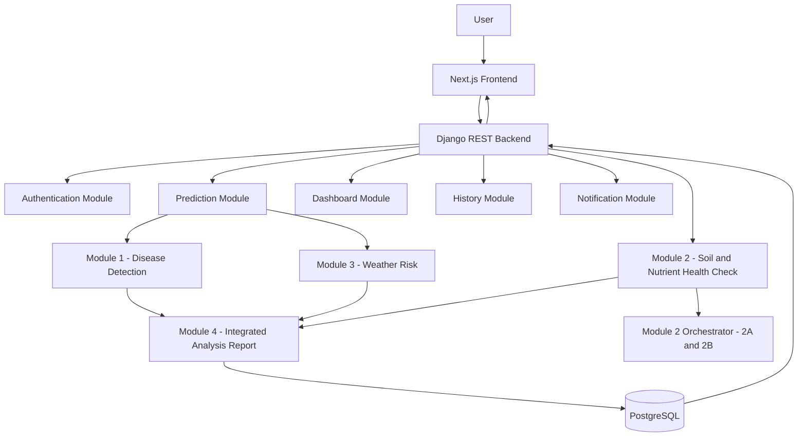
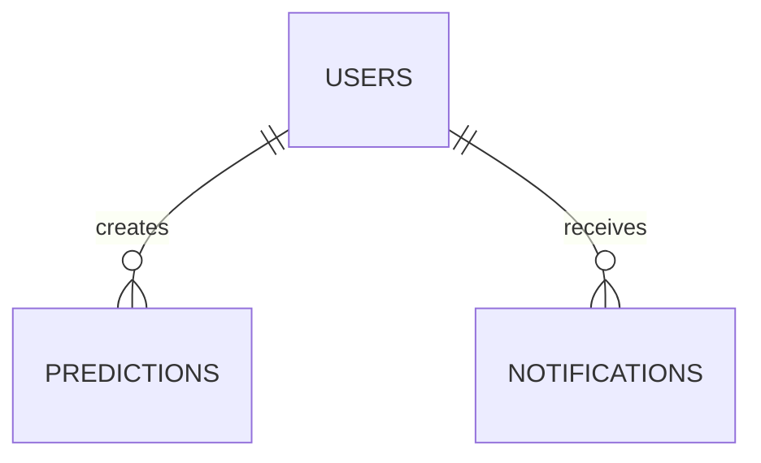

# GreenGuard System Specification V2

Version: 2.0

Project Name:
GreenGuard – AI Powered Intelligent Plant Health Monitoring and Crop Recommendation System

Document Version:
2.0

Prepared By:
Minahil Kamran
Laiba Farooq
Hamia Khalil

Project Type:
Final Year Project (BS Computer Science)

Document Purpose

This document serves as the official software specification for the GreenGuard system. It provides a comprehensive blueprint for designing, developing, testing, deploying, and maintaining the application.

The specification defines the system architecture, functional modules, database structure, REST APIs, frontend and backend responsibilities, AI integration, security requirements, development workflow, deployment strategy, and coding standards.

This document acts as the single source of truth for all development activities and should be followed by every member of the development team.

---

# 1. Project Overview

GreenGuard is an AI-powered web application designed to assist farmers in monitoring plant health, detecting crop diseases, recommending suitable crops and varieties, and assessing environmental risks using a multimodal intelligent decision-making approach.

Unlike traditional agricultural applications that focus only on plant disease detection, GreenGuard runs three independent AI modules that each analyze a different aspect of crop health, and presents their results together in one analysis report.

GreenGuard's AI modules are:

• Module 1 — Disease Detection (computer vision on a leaf photo)

• Module 2 — Soil & Nutrient Health (farmer questionnaire + nutrient-risk model)

• Module 3 — Weather Risk (Open-Meteo weather + rule engine)

Module 4 is the Integrated Analysis Report: the application layer that shows the three module results side by side. It does not run an AI model and does not combine the results into a single diagnosis — each result stays separate and traceable to the module that produced it.

> **Architecture note (2026-10-03):** earlier versions of this specification described Module 4 as an "ANN Fusion Layer" producing a final diagnosis, confidence and recommendations. That design was retired before any Fusion model was delivered. GreenGuard has no Fusion model, no ANN Fusion and no Fusion service.

GreenGuard follows a modular Client–Server architecture where the frontend communicates with the backend through REST APIs, while the backend coordinates with specialized AI modules responsible for disease detection, crop recommendation, weather risk analysis, and final prediction generation.

The system is intended to support farmers, agricultural experts, researchers, and administrators by providing an easy-to-use platform for intelligent crop monitoring and data-driven agricultural decision making.

---

# 2. Problem Statement

Farmers often face significant challenges in identifying plant diseases, selecting suitable crops, and responding to changing environmental conditions.

Traditional diagnosis methods rely heavily on manual inspection and expert consultation, which can be time-consuming, costly, and inaccessible for many farmers, particularly in rural areas.

Most existing agricultural systems focus on a single task, such as disease detection, without considering soil characteristics, weather conditions, or crop suitability. As a result, recommendations may be incomplete or less reliable.

Furthermore, farmers typically use separate tools for disease diagnosis, weather monitoring, and crop planning, requiring them to manually combine information from multiple sources.

GreenGuard addresses these limitations by integrating multiple AI-powered modules into a single intelligent platform capable of analyzing plant images, soil properties, and environmental conditions to generate comprehensive crop health assessments and actionable recommendations.

---

# 3. Vision

To build an intelligent, scalable, and user-friendly agricultural decision support system that empowers farmers with AI-driven insights for healthier crops, improved productivity, and sustainable farming practices.

---

# 4. Mission

The mission of GreenGuard is to provide an integrated AI platform capable of:

• Detecting plant diseases from leaf images.

• Assessing soil and nutrient health from a farmer questionnaire.

• Recommending suitable crops and crop varieties based on soil characteristics.

• Assessing environmental risks using real-time weather information.

• Presenting the independent results of every AI module together in one clear analysis report.

• Delivering clear recommendations through a modern web application accessible from any device.

---

# 5. Project Objectives

The primary objectives of GreenGuard are:

• Develop a responsive web-based agricultural monitoring system.

• Detect plant diseases using deep learning–based image analysis.

• Assess soil and nutrient health risks from a farmer questionnaire.

• Analyze soil properties to recommend the most suitable crop and variety.

• Retrieve environmental information using the Weather Risk Module (Open-Meteo-backed; see Section 24.5).

• Assess weather-related agricultural risks.

• Present the outputs of all AI modules together in one integrated analysis report, without merging them.

• Provide farmers with accurate recommendations and confidence scores.

• Maintain prediction history for future reference.

• Offer administrative tools for monitoring users, AI modules, and system performance.

---

# 6. Scope

GreenGuard focuses on providing intelligent agricultural assistance through a modular AI architecture.

The system includes:

• User authentication and authorization.

• Plant image upload.

• Soil parameter submission.

• Farm location selection.

• Disease detection.

• Soil & nutrient health analysis.

• Crop recommendation.

• Crop variety recommendation.

• Weather risk analysis.

• Integrated analysis report (Module 4).

• Prediction history.

• Notifications.

• Dashboard analytics.

• User profile management.

• Administrative dashboard.

The current version is designed as a web application optimized for desktop and tablet devices, with future support planned for mobile applications and IoT sensor integration.

---

# 7. Stakeholders

The GreenGuard system serves multiple stakeholders.

Primary Stakeholders

• Farmers

• Agricultural Experts

• Researchers

• System Administrators

Secondary Stakeholders

• Universities

• Agricultural Organizations

• AI Development Team

• Backend Development Team

• Frontend Development Team

• Future Contributors

---

# 8. Expected Outcomes

Upon successful completion, GreenGuard will provide:

• A fully functional AI-powered agricultural web application.

• Accurate plant disease detection.

• Intelligent crop and variety recommendations.

• Weather-based agricultural risk assessment.

• Centralized prediction management.

• Modular REST API architecture.

• Secure authentication and authorization.

• Scalable backend infrastructure.

• Modern responsive user interface.

• Production-ready software architecture suitable for future expansion.
# 9. Functional Requirements

Functional requirements describe the features and operations that the GreenGuard system must perform.

The system is divided into multiple functional modules, each responsible for a specific business process.

---

# 9.1 User Authentication Module

The Authentication Module manages user identity and secure system access.

The system shall allow users to:

• Register a new account.

• Log in using email and password.

• Log out securely.

• Reset forgotten passwords.

• Change their password.

• Authenticate using JWT tokens.

• Maintain secure user sessions.

• Restrict unauthorized access to protected resources.

---

# 9.2 Dashboard Module

The Dashboard serves as the central interface after user login.

The dashboard shall display:

• Welcome message.

• Quick Scan shortcut.

• Recent Predictions.

• Weather Summary.

• Recent Recommendations.

• Prediction Statistics.

• Notification Summary.

• User Profile shortcut.

The dashboard should load all required information using optimized API requests.

---

# 9.3 Plant Analysis Module

The Plant Analysis Module allows users to analyze plant health.

The system shall allow users to:

• Upload a plant leaf image.

• Validate image format.

• Preview uploaded image.

• Submit image for AI analysis.

Module 1 (Disease Detection) shall detect:

• Plant Disease (or a healthy leaf), for wheat, rice, cotton, maize, sugarcane, tomato and potato

The system shall display:

• Disease Name

• Confidence Score

• Crop and Health Status

• The top 3 possible results — shown as "Possible results" when the model is uncertain and returns no single prediction

• Any image-quality warnings returned by the module

---

# 9.4 Module 2 — Soil & Nutrient Health Check

This module is a standalone questionnaire-based feature, independent of the Plant Image Prediction workflow (Section 9.3). A farmer runs a Soil & Nutrient Health Check for a farm without uploading a leaf image, and vice versa.

The system shall allow users to answer a farmer-friendly questionnaire:

• Crop and growth stage

• Soil type (texture-based, e.g. sandy, loamy, clay)

• Last fertilizer used and how long ago (skipped when no fertilizer was used)

• Irrigation source and adequacy

• Visible leaf/plant symptoms (checklist)

Weather values (temperature, humidity, 7-day rainfall) are resolved automatically from the farm's stored location via the existing Weather Module (Section 9.5) — the farmer never enters them manually.

Three advanced fields — soil pH, soil moisture %, and light intensity — are optional and may be left blank; they are collected for future use and do not affect the current model's output.

Internally, the backend routes this questionnaire to a Module 2 Orchestrator, which combines Module 2A (nutrient-risk ML model) and Module 2B (pH/soil comparison). The frontend only ever calls the one public Module 2 endpoint.

The AI module shall provide:

• Nitrogen, Phosphorus, Potassium, Magnesium, Zinc, and Boron risk levels (High / Medium / Low), each with a confidence value

• An overall nutrient health rating (Good / Moderate / Poor)

• A pH / soil moisture / light comparison against ideal ranges, with a nutrient-lockout explanation when pH is out of range

• An overall soil health score (0–100) and label (Good / Moderate / Poor)

Seven UI-enabled crops (the gourd family) are not yet supported by the trained model — for these, the system returns a "coming soon" result instead of calling the model. See REST_API_SPEC.md Section 8A for the exact request/response contract.

---

# 9.5 Weather Risk Module

The Weather Module evaluates environmental conditions.
Each farm shall store its geographic coordinates (latitude and longitude) during farm creation. These coordinates are used by the Weather Module for retrieving weather information.

The system shall:

• Retrieve weather information using the Weather Risk Module (Open-Meteo-backed; see Section 24.5).

• Analyze environmental conditions.

• Display:

  • Temperature

  • Humidity

  • Rainfall

  • Wind Speed

The AI module shall estimate:

• Fungal Disease Risk

• Heat Stress Risk

• Drought Risk

---

# 9.6 Module 4 — Integrated Analysis Report

Module 4 is the application-level report layer. It is not an AI model and not a separate service.

It brings together:

• Disease Detection Output (Module 1)

• Soil & Nutrient Health Output (Module 2) — the farm's latest persisted Module2Analysis result, never a live call (Module 2 needs the farmer's questionnaire)

• Weather Risk Output (Module 3)

and stores them side by side as one analysis record. It does not produce a final diagnosis, a combined confidence score or recommendations of its own; each module's result is shown as its own section. See REST_API_SPEC.md, "Module 4", for the stored structure.

---

# 9.7 Prediction Report Module

After successful analysis, the system shall generate a comprehensive prediction report.

The report shall include:

• Uploaded Image

• Disease Detection Result (Module 1) — including the top 3 possible results and any warnings

• Soil & Nutrient Health Result (Module 2) — the farm's latest result, or a prompt to run a Soil Test

• Weather Risk Result (Module 3) — conditions, environmental risks and forecast

Each section is labelled with the module that produced it. Module 2 (Soil & Nutrient Health Check) is also a separate, standalone feature (Section 9.4) usable independently of the prediction workflow.

The report shall be saved in prediction history.

---

# 9.8 Prediction History Module

The Prediction History Module stores all previous analyses.

Users shall be able to:

• View prediction history.

• Search predictions.

• Filter predictions.

• View prediction details.

• Delete prediction records.

Prediction history shall be ordered from newest to oldest.

---

# 9.9 Notification Module

The Notification Module informs users about important events.

Notifications include:

• Prediction Completed

• High Disease Risk

• Weather Alerts

• System Announcements

• Recommendation Updates

Users shall be able to:

• View notifications.

• Mark notifications as read.

• Delete notifications.

---

# 9.10 User Profile Module

Users shall be able to:

• View profile.

• Update profile.

• Change profile picture.

• Delete account.

---

# 9.11 Admin Module

The Admin Dashboard provides centralized system management.

Administrators shall be able to:

• View all users.

• Manage user accounts.

• View prediction statistics.

• Monitor AI module status.

• Monitor backend services.

• View system health.

• Manage prediction records.

• View platform analytics.

---

# 10. User Roles

GreenGuard supports Role-Based Access Control (RBAC).

---

## Farmer

Permissions:

• Register

• Login

• Upload plant image

• Enter soil parameters

• View prediction reports

• View dashboard

• Manage profile

• View notifications

• View prediction history

---

## Administrator

Permissions:

• All Farmer permissions

• Manage users

• Manage predictions

• Monitor AI modules

• View analytics

• Monitor system health

• Access admin dashboard

---

# 11. System Features

The GreenGuard system provides the following major features.

Core Features

• User Authentication

• Dashboard

• Plant Image Analysis

• Soil & Nutrient Health Check (Module 2, standalone)

• Weather Risk Assessment

• Integrated Analysis Report (Module 4)

• Prediction Reports

• Prediction History

• Notifications

• Profile Management

• Admin Dashboard

Supporting Features

• JWT Authentication

• REST APIs

• PostgreSQL Database

• File Upload

• Weather Risk Module Integration (Open-Meteo-backed)

• Responsive UI

• Secure Communication

---

# 12. Use Case Summary

| ID | Use Case | Actor |
|----|-------------------------------|---------------|
| UC-01 | Register Account | Farmer |
| UC-02 | Login | Farmer |
| UC-03 | Upload Plant Image | Farmer |
| UC-04 | Complete Soil & Nutrient Health Questionnaire (Module 2) | Farmer |
| UC-05 | Select Farm Location | Farmer |
| UC-06 | Analyze Crop Health (Image + Weather) | Farmer |
| UC-07 | View Prediction Report | Farmer |
| UC-08 | View Dashboard | Farmer |
| UC-09 | View Prediction History | Farmer |
| UC-10 | Manage Profile | Farmer |
| UC-11 | View Notifications | Farmer |
| UC-12 | Logout | Farmer |
| UC-13 | Manage Users | Admin |
| UC-14 | Monitor AI Modules | Admin |
| UC-15 | View System Health | Admin |
| UC-16 | View Analytics | Admin |
| UC-17 | Manage Predictions | Admin |

---

# 13. Business Rules

The GreenGuard system shall follow these business rules.

• Every prediction must belong to a registered user.

• Every uploaded image shall be validated before processing.

• The Module 2 questionnaire must be fully answered (required fields) before a Soil & Nutrient Health Check can run; the three advanced fields (pH, soil moisture, light) remain optional.

• Farm location is required for weather analysis, including the weather values auto-resolved for Module 2.

• No combined or "final" diagnosis is generated: every result shown comes from the module that produced it.

• Prediction reports shall be stored in the database.

• Users may access only their own prediction history.

• Administrators may access all prediction records.

• JWT Authentication is required for all protected APIs.

• AI modules shall not communicate directly with the frontend.

• All communication between frontend and backend shall use REST APIs.

# 14. Technology Stack

GreenGuard is built using a modern full-stack architecture that separates the frontend, backend, database, AI modules, and external services into independent components.

This modular approach improves scalability, maintainability, security, and future extensibility.

---

# 14.1 Frontend Technologies

| Technology | Purpose |
|------------|---------------------------------------------|
| Next.js | Frontend Framework |
| React | Component-Based UI Development |
| TypeScript | Type Safety |
| Tailwind CSS | Responsive UI Styling |
| Shadcn UI | Modern UI Components |
| React Hook Form | Form Handling |
| Zod | Client-side Validation |
| Axios | API Communication |
| TanStack Query | API Caching & State Management |
| Lucide React | Icons |

---

# 14.2 Backend Technologies

| Technology | Purpose |
|------------|---------------------------------------------|
| Django | Backend Framework |
| Django REST Framework | REST API Development |
| JWT | Authentication |
| Django ORM | Database Operations |
| Pillow | Image Processing |
| Python | Backend Programming Language |

---

# 14.3 Database

| Technology | Purpose |
|------------|------------------------------|
| PostgreSQL | Primary Relational Database |

The database stores:

• User Accounts

• Prediction History

• Uploaded Images

• Notifications

• Dashboard Statistics

• AI Results

---

# 14.4 AI Technologies

| Technology | Purpose |
|------------|----------------------------------------------|
| TensorFlow / PyTorch | Deep Learning Models |
| OpenCV | Image Preprocessing |
| NumPy | Numerical Computation |
| Pandas | Data Processing |

---

# 14.5 External Services

| Service | Purpose |
|------------|----------------------------------------------|
| Weather Risk Module (Open-Meteo) | Weather Data |
| GitHub | Version Control |
| Docker | Containerization |
| Nginx | Reverse Proxy |
| Gunicorn | Django Application Server |

---

# 15. High-Level Architecture

GreenGuard follows a Layered Client–Server Architecture.

The system separates presentation, business logic, AI processing, and data management into independent layers.

This separation enables easier maintenance, scalability, testing, and future enhancements.

---

# 16. Architecture Layers

GreenGuard consists of five major layers.

---

## 16.1 Presentation Layer

Technology

• Next.js

Responsibilities

• User Interface

• Responsive Design

• Forms

• Dashboard

• Reports

• Authentication Pages

• Profile Management

• Notifications

• API Communication

The frontend never communicates directly with AI modules or the database.

---

## 16.2 Business Logic Layer

Technology

• Django REST Framework

Responsibilities

• Authentication

• Authorization

• Validation

• Request Processing

• API Management

• File Upload

• AI Coordination

• Database Operations

The backend acts as the central controller of the entire system.

---

## 16.3 AI Processing Layer

The AI Processing Layer contains three independent AI modules. Module 4 (below) is the application-level report built from their results.

Module 1

Disease Detection (live service)

Responsible for

• Disease Detection from one leaf photo (with a top-3 shortlist; may abstain when uncertain)

---

Module 2

Soil & Nutrient Health Check (standalone endpoint — see Section 9.4)

Responsible for

• Nutrient Risk Assessment (Nitrogen, Phosphorus, Potassium, Magnesium, Zinc, Boron)

• Soil / pH / Light Comparison and Nutrient Lockout Analysis

• Overall Soil Health Score

Its latest result for a farm is also included in every Quick Scan report (Module 4).

---

Module 3

Weather Risk Engine

Responsible for

• Temperature Analysis

• Humidity Analysis

• Rainfall Analysis

• Wind Speed Analysis

• Risk Assessment

---

Module 4

Integrated Analysis Report (application layer — not an AI module)

Responsible for

• Storing the Module 1, 2 and 3 results together as one analysis record

• Displaying them side by side, each clearly labelled with its source module

Module 4 runs no model and never combines results into a final diagnosis, confidence or recommendation.

---

## 16.4 Data Layer

Technology

PostgreSQL

Responsibilities

• Store Users

• Store Predictions

• Store Reports

• Store Notifications

• Store Dashboard Data

• Store Prediction History

The AI modules do not access the database directly.

---

## 16.5 External Services Layer

Services

• Weather Risk Module (Open-Meteo-backed)

Responsibilities

• Weather Data Retrieval

• Environmental Data

• Risk Assessment Support

---

# 17. System Architecture Workflow

The overall workflow is as follows.

User

↓

Next.js Frontend

↓

REST API Request

↓

Django Backend

↓

Request Validation

↓

Store Uploaded Image

↓

Image Analysis Module

↓

Farm's Latest Persisted Module 2 (Soil & Nutrient Health) Result — not invoked live

↓

Weather Risk Module

↓

Module 4 — Integrated Analysis Report

↓

Save Prediction

↓

PostgreSQL

↓

Return Final Report

↓

Frontend Dashboard

---

# 18. Component Responsibilities

## Frontend

Responsible for

• User Interaction

• Form Validation

• Image Preview

• Dashboard

• Reports

• History

• Notifications

• API Calls

---

## Backend

Responsible for

• Authentication

• Authorization

• Validation

• Business Logic

• API Management

• Database Operations

• AI Integration

• Prediction Storage

---

## AI Modules

Responsible for

• Image Analysis

• Soil & Nutrient Health Check (Module 2, standalone)

• Weather Risk Analysis

• Integrated Analysis Report (Module 4)

---

## Database

Responsible for

• Persistent Storage

• User Management

• Prediction Records

• Notifications

• Reports

---

# 19. Client–Server Communication

GreenGuard follows RESTful communication.

Frontend

↓

HTTPS

↓

REST API

↓

Backend

↓

AI Modules

↓

Database

↓

REST Response

↓

Frontend

All communication uses JSON.

JWT Authentication protects secured endpoints.

---

# 20. Architectural Principles

The GreenGuard architecture follows these principles.

• Separation of Concerns

• Modular Design

• Loose Coupling

• High Cohesion

• Stateless REST APIs

• Secure Authentication

• Layered Architecture

• Scalable Backend

• Reusable Components

• Independent AI Modules

• Centralized Business Logic

• Database Abstraction through Django ORM

---

# 21. High-Level Component Diagram

Module 2 is also called independently of the Prediction Module for the standalone Soil Health feature. Its latest persisted result for the farm is included in the Integrated Analysis Report (Module 4) — Module 2 is not re-invoked live for this purpose. Module 4 is an application-level report, not an AI model.
---
# 22. Architectural Advantages
The selected architecture provides:
• Modular AI Integration
• Independent Frontend & Backend Development
• Easy Maintenance
• Improved Scalability
• Better Security
• Faster Testing
• Future Expandability
• Clean Separation of Responsibilities
• Production-Ready Design
• Simplified Deployment
---
# 23. Future Scalability
The architecture supports adding new AI modules without changing the existing system.
Possible future modules include:
• Pest Severity Prediction
• Irrigation Recommendation
• Fertilizer Optimization
• Yield Prediction
• Satellite Image Analysis
• IoT Sensor Integration
• Mobile Application
• Multi-language Support
• Offline Prediction Support
• Drone Image Analysis

# 24. System Modules

GreenGuard is organized into independent functional modules.

Each module has a clearly defined responsibility and communicates with other modules only through the Django Backend.

This modular design improves maintainability, scalability, and future extensibility.

---

# 24.1 Authentication Module

## Purpose

Provides secure user authentication and authorization.

---

## Responsibilities

• User Registration

• User Login

• User Logout

• Password Reset

• Password Change

• JWT Authentication

• Session Management

---

## Inputs

• Full Name

• Email Address

• Password

---

## Outputs

• JWT Access Token

• JWT Refresh Token

• Authenticated User Information

---

## APIs Used

POST /api/v1/auth/register/

POST /api/v1/auth/login/

POST /api/v1/auth/logout/

POST /api/v1/auth/refresh/

POST /api/v1/auth/forgot-password/

POST /api/v1/auth/reset-password/

POST /api/v1/auth/change-password/

---

## Database Tables

• Users

---

# 24.2 Dashboard Module

## Purpose

Provides users with a summary of their agricultural activities and AI predictions.

---

## Responsibilities

• Display Dashboard

• Display Recent Predictions

• Display Weather Summary

• Display Recommendation Summary

• Display Notification Count

• Display Quick Scan Shortcut

---

## APIs Used

GET /api/v1/dashboard/

GET /api/v1/dashboard/weather/

GET /api/v1/dashboard/recent-predictions/

GET /api/v1/dashboard/recommendations/

---

## Database Tables

• Predictions

• Notifications

---

# 24.3 Image Analysis Module

## Purpose

Analyzes uploaded leaf images using Computer Vision.

---

## Responsibilities

• Image Validation

• Image Preprocessing

• Disease Detection

---

## Input

Leaf Image, plus the crop when the farmer has chosen one

---

## Output

• Status (`ok` or `uncertain`)

• Prediction — disease display name, crop, healthy flag and confidence (null when uncertain)

• Top 3 possible results with confidences

• Warnings and message

• Model version and request ID

The exact contract is in `ai/API_CONTRACT.md` and REST_API_SPEC.md, "AI Module 1".

---

## AI Technologies

• TensorFlow / PyTorch

• OpenCV

---

## Internal Output

Returns the standardized JSON defined in:

REST_API_SPEC.md

Module 1 Contract

---

# 24.4 Module 2 — Soil & Nutrient Health Check

## Purpose

Analyzes a farmer questionnaire, resolved weather, and optional advanced readings to assess nutrient risk and soil health. Exposed as a standalone public endpoint, independent of the Prediction Module (24.7).

---

## Responsibilities

• Nutrient Risk Assessment (Module 2A)

• Soil / pH / Light Comparison and Nutrient Lockout Analysis (Module 2B)

• Overall Soil Health Scoring

---

## Inputs

• Crop, Growth Stage

• Soil Type

• Last Fertilizer Type, Days Since Fertilizer

• Irrigation Source, Irrigation Adequacy

• Visible Symptoms (checklist)

• Temperature, Humidity, 7-Day Rainfall — resolved automatically from the farm's location via the Weather Module (24.5), not entered by the farmer

• Soil pH, Soil Moisture %, Light Intensity — optional, `null` when unknown

---

## Outputs

• Nitrogen, Phosphorus, Potassium, Magnesium, Zinc, Boron Risk (level + confidence)

• Overall Nutrient Health

• pH / Soil Moisture / Light Status and Nutrient Lockout Note

• Overall Soil Health Score and Label

---

## Internal Output

Returns the standardized JSON defined in:

REST_API_SPEC.md

Section 8A / AI Module 2

---

# 24.5 Weather Risk Module

**Delivered as:** `ai/Weather_Module` (FastAPI + Open-Meteo + rule engine, with an additive LSTM next-day forecast). Originally specified against NASA POWER below; switched to Open-Meteo because NASA POWER's most recent days are unprocessed placeholders and cannot serve genuinely live conditions — see REST_API_SPEC.md Section 9 ("AI Module 3") for the authoritative, current contract this chapter's outputs are superseded by.

## Purpose

Analyzes weather conditions using the Weather Risk Module (Open-Meteo-backed as of the real Module 3 delivery; originally specified against NASA POWER API).

---

## Responsibilities

• Retrieve Weather Data

• Calculate Environmental Risks

• Support Final Prediction

---

## Inputs

• Latitude

• Longitude

---

## Outputs

• Temperature

• Humidity

• Rainfall

• Wind Speed

• Fungal Disease Risk

• Heat Stress Risk

• Drought Risk

---

## External Service

Open-Meteo API, via the ai/Weather_Module Module 3 microservice (originally specified as NASA POWER API — see the note at the top of this chapter)

---

## Internal Output

Returns the standardized JSON defined in:

REST_API_SPEC.md

Module 3 Contract

---

# 24.6 Module 4 — Integrated Analysis Report

## Purpose

Presents the independent results of Modules 1, 2 and 3 together as one analysis report.

---

## Responsibilities

• Store the Disease Detection result (Module 1), verbatim

• Store the farm's latest Soil & Nutrient Health result (Module 2), verbatim — or null when none exists

• Store the Weather Risk result (Module 3), verbatim

• Display each result in its own clearly labelled section

---

## Not Responsible For

Module 4 is not an AI model. It never generates a final diagnosis, an overall confidence, contributing factors or recommendations, and never modifies a module's result.

---

## Output

One Prediction record whose `prediction_report` holds `module1`, `module2` and `module3` — see REST_API_SPEC.md, "Module 4".

---

# 24.7 Prediction Module

## Purpose

Coordinates the complete prediction workflow.

---

## Responsibilities

• Validate Request

• Save Uploaded Image

• Invoke AI Modules

• Collect AI Outputs

• Save Final Prediction

• Return Prediction Report

---

## Workflow

Upload Image

↓

Validate Request

↓

Store Image

↓

Run Disease Detection (Module 1)

↓

Attach Latest Soil & Nutrient Result (Module 2)

↓

Run Weather Risk (Module 3)

↓

Save Prediction (Module 4 — Integrated Analysis Report)

↓

Return Report

---

## APIs Used

POST /api/v1/predictions/analyze/

GET /api/v1/predictions/

GET /api/v1/predictions/{prediction_id}/

DELETE /api/v1/predictions/{prediction_id}/

---

## Database Tables

• Predictions

---

# 24.8 Prediction History Module

## Purpose

Maintains historical prediction records.

---

## Responsibilities

• Store Predictions

• Retrieve Prediction History

• Search Records

• Filter Records

• Delete Records

---

## APIs Used

GET /api/v1/history/

GET /api/v1/history/{prediction_id}/

DELETE /api/v1/history/{prediction_id}/

---

## Database Tables

• Predictions

---

# 24.9 Notification Module

## Purpose

Provides system notifications to users.

---

## Responsibilities

• Generate Notifications

• Display Notifications

• Mark as Read

• Delete Notifications

---

## Notification Types

• Prediction Completed

• Weather Alert

• High Disease Risk

• Recommendation Available

• System Announcement

---

## APIs Used

GET /api/v1/notifications/

PUT /api/v1/notifications/{notification_id}/read/

DELETE /api/v1/notifications/{notification_id}/

---

## Database Tables

• Notifications

---

# 24.10 User Profile Module

## Purpose

Manages user information.

---

## Responsibilities

• View Profile

• Update Profile

• Change Profile Picture

• Delete Account

---

## APIs Used

GET /api/v1/profile/

PUT /api/v1/profile/

DELETE /api/v1/profile/

---

## Database Tables

• Users

---

# 24.11 Admin Module

## Purpose

Provides centralized administration and system monitoring.

---

## Responsibilities

• Manage Users

• Manage Predictions

• View Statistics

• Monitor AI Services

• Monitor System Health

• View Analytics

---

## Dashboard Widgets

• Total Users

• Active Users

• Total Predictions

• AI Module Status

• System Health

• Prediction Trends

---

## APIs Used

GET /api/v1/admin/dashboard/

GET /api/v1/admin/users/

GET /api/v1/admin/predictions/

GET /api/v1/admin/statistics/

GET /api/v1/admin/system-health/

GET /api/v1/admin/ai-monitoring/

---

## Database Tables

• Users

• Predictions

• Notifications

---

# 25. Module Communication Rules

The following communication rules must always be followed.

• Frontend communicates only with Django REST APIs.

• Django Backend communicates with AI modules.

• AI modules never communicate with the frontend.

• AI modules never access PostgreSQL directly.

• Django Backend is responsible for all database operations.

• The Weather Risk Module (`ai/Weather_Module`) is the only component that talks to an external weather provider (Open-Meteo).

• The Integrated Analysis Report (Module 4) stores the outputs of the Disease Detection Module (Module 1), the Soil & Nutrient Health Module (Module 2 — the farm's latest persisted result, not a live call) and the Weather Risk Module (Module 3) side by side. Module 4 is not an AI model and never combines them.

• All modules return JSON responses.

• JWT authentication protects all private modules.

• Modules should remain independent and loosely coupled to simplify maintenance and future expansion.

# 26. Database Specification

## 26.1 Overview

GreenGuard uses PostgreSQL as its primary relational database management system.

The database stores all persistent application data including user accounts, prediction history, uploaded images, notifications, dashboard statistics, and administrative information.

The AI modules do not communicate directly with the database.

All database operations are performed through the Django Backend using the Django ORM.

---

# 26.2 Database Objectives

The database is designed to:

• Store user information securely.

• Store uploaded plant images.

• Store prediction history.

• Store AI prediction reports.

• Store weather analysis.

• Store notifications.

• Support dashboard analytics.

• Maintain data integrity.

• Enable future scalability.

---

# 26.3 Database Management System

Database Engine

PostgreSQL

ORM

Django ORM

Database Naming Convention

greenguard_db

---

# 26.4 Main Database Tables

The GreenGuard database consists of the following primary tables.

| Table | Purpose |
|---------|----------------------------------------------|
| users | Stores user accounts |
| predictions | Stores complete prediction reports |
| notifications | Stores user notifications |
| user_sessions | Stores active login sessions (optional) |

Additional tables generated by Django include:

• django_migrations

• django_admin_log

• django_content_type

• django_session

• django_permissions

• django_groups

---

# 26.5 Entity Relationship Overview

The database relationships are designed as follows.

One User

↓

Many Predictions

One User

↓

Many Notifications

Each Prediction

↓

One Uploaded Image

Each Prediction

↓

One AI Report

---

# 26.6 High-Level Entity Relationship Diagram

---

# 26.7 Table Descriptions

## Users

Stores authentication and profile information.

Contains

• Personal Information

• Login Credentials

• User Role

• Profile Image

• Account Status

---

## Predictions

Stores each Quick Scan analysis report generated by GreenGuard.

Each prediction contains:

• Uploaded Image Path

• Disease Detection Output (Module 1)

• Soil & Nutrient Health Output (Module 2 — the farm's latest result, or null)

• Weather Risk Output (Module 3)

• Prediction Timestamp

Module 2 (Soil & Nutrient Health Check) is also a separate, standalone feature usable independently of the prediction workflow.

---

## Notifications

Stores notifications generated by the system.

Examples

• Prediction Completed

• Weather Alert

• High Disease Risk

• Recommendation Available

• System Announcement

---

# 26.8 Database Relationships

Relationship 1

User

↓

Predictions

Type

One-to-Many

Meaning

One user can have many prediction reports.

---

Relationship 2

User

↓

Notifications

Type

One-to-Many

Meaning

One user can receive many notifications.

---

# 26.9 Database Constraints

The database should enforce the following constraints.

Primary Keys

Every table must contain a primary key.

Foreign Keys

Relationships must be maintained using foreign keys.

Unique Constraints

• Email Address

Not Null Constraints

Required fields must not contain NULL values.

Indexes

Frequently searched fields should be indexed.

---

# 26.10 Data Integrity Rules

The system must ensure:

• Duplicate email addresses are not allowed.

• Every prediction belongs to an existing user.

• Every notification belongs to an existing user.

• Deleted users must not leave orphan prediction records.

• Uploaded image paths must remain valid.

• Prediction timestamps are automatically generated.

---

# 26.11 Database Access Rules

Only the Django Backend may access PostgreSQL.

The frontend must never access the database directly.

The AI modules must never communicate directly with PostgreSQL.

All database communication must pass through the Django Backend.

---

# 26.12 ORM Strategy

GreenGuard uses Django ORM to perform database operations.

Benefits include:

• SQL Injection Protection

• Database Abstraction

• Easier Maintenance

• Cleaner Code

• Migration Support

• Better Readability

---

# 26.13 Database Backup Strategy

The production database should support:

• Automatic Daily Backup

• Weekly Full Backup

• Recovery Support

• Backup Verification

---

# 26.14 Future Database Expansion

The schema has been designed to allow additional tables in future versions.

Possible future tables include:

• IoT Sensor Data

• Fertilizer Recommendations

• Irrigation Recommendations

• Pest Severity Analysis

• Yield Prediction

• Drone Imagery

• Farm Management

• Crop Calendar

• Disease Knowledge Base

---

# 26.15 Database Design Principles

The GreenGuard database follows these principles:

• Normalized Design

• High Data Integrity

• Secure Storage

• Scalable Architecture

• Minimal Data Redundancy

• Efficient Relationships

• Easy Maintenance

• Future Expandability
# 27. Frontend Specification

## 27.1 Overview

The GreenGuard frontend is developed using **Next.js** with **TypeScript** and **Tailwind CSS**.

It provides a modern, responsive, and user-friendly interface for farmers and administrators to interact with the GreenGuard system.

The frontend communicates exclusively with the Django REST Backend using REST APIs.

No business logic or AI processing is performed on the frontend.

---

# 27.2 Frontend Technology Stack

| Technology | Purpose |
|------------|-------------------------------------------|
| Next.js | React Framework |
| React | Component-Based UI |
| TypeScript | Static Type Checking |
| Tailwind CSS | Styling Framework |
| Shadcn UI | Modern UI Components |
| React Hook Form | Form Handling |
| Zod | Form Validation |
| Axios | REST API Communication |
| TanStack Query | Server State Management |
| Lucide React | Icons |

---

# 27.3 Frontend Responsibilities

The frontend is responsible for:

• Rendering all user interfaces.

• Handling user interactions.

• Performing client-side validation.

• Uploading plant images.

• Collecting soil parameters.

• Selecting farm location.

• Displaying prediction reports.

• Displaying dashboard statistics.

• Managing authentication.

• Calling backend REST APIs.

• Displaying loading states and error messages.

---

# 27.4 Application Pages

The GreenGuard frontend consists of the following pages.

## Public Pages

• Landing Page

• Login

• Register

• Forgot Password

• Reset Password

---

## User Pages

• Dashboard

• Quick Scan

• Prediction Report

• Prediction History

• Notifications

• Profile

---

## Admin Pages

• Admin Dashboard

• User Management

• Prediction Management

• AI Monitoring

• System Health

---

# 27.5 Folder Structure

frontend/

app/

components/

hooks/

lib/

services/

types/

utils/

public/

styles/

---

# 27.6 Component Architecture

The frontend follows a reusable component-based architecture.

Common Components

• Navbar

• Sidebar

• Footer

• Button

• Input Field

• Select Menu

• Modal

• Dialog

• Card

• Badge

• Toast

• Loading Spinner

• Pagination

• Data Table

• Search Bar

• Weather Card

• Prediction Card

• Recommendation Card

---

# 27.7 Authentication Flow

User

↓

Login Page

↓

Validate Form

↓

POST Login API

↓

Receive JWT Token

↓

Store Token Securely

↓

Redirect to Dashboard

---

# 27.8 Dashboard Layout

The Dashboard contains:

• Welcome Banner

• Quick Scan Card

• Recent Predictions

• Weather Summary

• Recommendations Summary

• Notification Panel

• Profile Shortcut

• Dashboard Statistics

---

# 27.9 Quick Scan Page

The Quick Scan page is the core feature of GreenGuard.

The page shall allow users to:

• Upload a plant image.

• Preview the uploaded image.

• Enter soil parameters.

• Select farm location.

• Submit prediction request.

The page shall perform client-side validation before sending data to the backend.

---

# 27.10 Prediction Report Page

After analysis, the Prediction Report page shall display:

## Disease Detection (Module 1)

• Disease Name and Confidence

• Crop and Health Status

• Closely Related / Possible Results (top 3)

• Warnings

---

## Soil & Nutrient Health (Module 2)

• The farm's latest Soil & Nutrient Health result, or a prompt to run one

---

## Weather Risk (Module 3)

• Temperature

• Humidity

• Rainfall

• Wind Speed

• Environmental Risks

• Next-day Forecast (when available)

There is no "Final Diagnosis" section: each module's result is shown on its own.

The report should provide a clean, easy-to-read layout using cards and sections.

---

# 27.11 Prediction History Page

Users can:

• View all previous predictions.

• Search predictions.

• Filter predictions.

• View detailed reports.

• Delete prediction records.

---

# 27.12 Notification Page

Displays:

• Weather Alerts

• Prediction Updates

• System Notifications

Users can:

• Mark notifications as read.

• Delete notifications.

---

# 27.13 Profile Page

Allows users to:

• View profile information.

• Update personal details.

• Change profile picture.

• Change password.

• Delete account.

---

# 27.14 Admin Dashboard

The Admin Dashboard provides:

• User Statistics

• Prediction Statistics

• AI Module Status

• System Health

• User Management

• Prediction Management

• Platform Analytics

---

# 27.15 State Management

GreenGuard uses:

• React State for local UI state.

• TanStack Query for server state.

• React Context for authentication.

The frontend should avoid unnecessary global state.

---

# 27.16 API Communication

All API communication shall use Axios.

Features include:

• JWT Token Injection

• Automatic Error Handling

• Request Interceptors

• Response Interceptors

• API Timeout Handling

---

# 27.17 Form Validation

Forms shall use:

• React Hook Form

• Zod Validation

Validation occurs before API requests are sent.

---

# 27.18 Responsive Design

The interface must support:

• Desktop

• Laptop

• Tablet

Mobile responsiveness should also be considered for future versions.

---

# 27.19 UI/UX Design Guidelines

The GreenGuard interface should follow a clean, modern, and agriculture-inspired design.

Design Principles

• Minimalist Layout

• Easy Navigation

• High Readability

• Consistent Spacing

• Clear Visual Hierarchy

• Responsive Design

---

# 27.20 Color Palette

The application should use the approved GreenGuard color scheme.

Primary Color

Deep Green

Secondary Color

Light Green

Accent Color

Leaf Green

Background

Soft White

Cards

White

Text

Dark Gray

Status Colors

Success

Green

Warning

Orange

Error

Red

Information

Blue

---

# 27.21 Typography

Primary Font

Inter

Fallback

System UI Fonts

Font Weights

400

500

600

700

---

# 27.22 Icons

Icons shall use Lucide React.

Examples

• Home

• Upload

• Scan

• User

• Bell

• History

• Dashboard

• Settings

• Logout

---

# 27.23 Frontend Design Principles

The frontend should always be:

• Responsive

• Accessible

• Fast

• Reusable

• Component-Based

• Type-Safe

• Maintainable

• User-Friendly

• Consistent

• Scalable

The implementation must follow the approved GreenGuard UI prototype and design language while keeping components modular for future enhancements.

# 28. Backend Specification

## 28.1 Overview

The GreenGuard backend is developed using **Django** and **Django REST Framework (DRF)**.

It acts as the central controller of the entire application by handling user authentication, business logic, database operations, AI module communication, external API integration, and REST API responses.

The backend is the only component allowed to communicate with the database and AI services.

---

# 28.2 Backend Technology Stack

| Technology | Purpose |
|------------|--------------------------------|
| Python | Programming Language |
| Django | Backend Framework |
| Django REST Framework | REST API Development |
| PostgreSQL | Database |
| Django ORM | Database Operations |
| JWT | Authentication |
| Pillow | Image Processing |
| Requests / HTTPX | External API Calls |
| Gunicorn | Production Server |

---

# 28.3 Backend Responsibilities

The backend is responsible for:

• User Authentication

• Authorization

• REST API Management

• Business Logic

• Database Operations

• File Upload Management

• AI Module Communication

• Weather Risk Module Communication

• Prediction Storage

• Dashboard Data Generation

• Notification Management

• Error Handling

• Logging

---

# 28.4 Backend Architecture

The backend follows a layered architecture.

Client

↓

REST API Layer

↓

Authentication Layer

↓

Business Logic Layer

↓

AI Integration Layer

↓

Database Layer

↓

PostgreSQL

This separation ensures maintainability and scalability.

---

# 28.5 Django Project Structure

backend/

manage.py

config/

authentication/

users/

predictions/

dashboard/

notifications/

adminpanel/

ai_services/

weather/

common/

media/

static/

requirements.txt

.env

---

# 28.6 Django Applications

### authentication

Responsible for:

• Registration

• Login

• JWT Authentication

• Password Management

---

### users

Responsible for:

• User Profile

• Account Management

---

### predictions

Responsible for:

• Prediction Workflow

• Report Generation

• Prediction History

---

### dashboard

Responsible for:

• Dashboard Statistics

• Weather Summary

• Recent Predictions

---

### notifications

Responsible for:

• User Notifications

• Alerts

---

### adminpanel

Responsible for:

• User Management

• Analytics

• AI Monitoring

• System Health

---

### ai_services

Responsible for:

• Image Module Communication

• Crop Recommendation Communication

• Weather Risk Communication

This application **does not perform AI inference**.

It only communicates with the deployed AI APIs.

---

### weather

Responsible for:

• Calling the Weather Risk Module (`ai/Weather_Module`, Open-Meteo-backed)

• Weather Data Formatting

---

### common

Contains:

• Shared Utilities

• Constants

• Validators

• Exceptions

• Permissions

• Middleware

---

# 28.7 Request Lifecycle

Every API request follows the same lifecycle.

Client Request

↓

Authentication

↓

Permission Check

↓

Input Validation

↓

Business Logic

↓

Database Operation

↓

AI Service (if required)

↓

Generate Response

↓

Return JSON

---

# 28.8 Authentication Flow

User

↓

Login Request

↓

Validate Credentials

↓

Generate JWT Tokens

↓

Return Tokens

↓

Authenticated Requests

↓

Protected APIs

---

# 28.9 Prediction Workflow

Prediction Request

↓

Validate Input

↓

Save Uploaded Image

↓

Call Disease Detection Module (Module 1)

↓

Include Farm's Latest Persisted Module 2 (Soil & Nutrient Health) Result — not invoked live

↓

Call Weather Module (Module 3)

↓

Save Prediction Report (Module 4 — the three results side by side)

↓

Return Report

---

# 28.10 AI Communication Strategy

The backend communicates with AI services using REST APIs.

The backend sends:

• Image

• Farm Location

The backend receives:

• Disease Detection (Module 1)

• Soil & Nutrient Health Result (Module 2)

• Weather Risk (Module 3)

(Module 2's Soil & Nutrient Health questionnaire is also independently callable as its own standalone request/response cycle — see Section 9.4 / 24.4. In a Quick Scan its output is the farm's latest persisted Module2Analysis result, not a live call.)

The backend never modifies the AI JSON structure.

---

# 28.11 Database Communication

All database operations are performed through Django ORM.

The backend is responsible for:

• Creating Records

• Reading Records

• Updating Records

• Deleting Records

No raw SQL should be used unless absolutely necessary.

---

# 28.12 File Upload Management

Supported Uploads

• Plant Leaf Images

Accepted Formats

• JPG

• JPEG

• PNG

Maximum File Size

Configured in Django settings.

Uploaded images are stored inside the media directory.

Only image files are accepted.

---

# 28.13 Error Handling

The backend shall return standardized JSON error responses.

Examples include:

• Validation Errors

• Authentication Errors

• Authorization Errors

• AI Service Unavailable

• Weather API Failure

• Database Errors

• Internal Server Errors

---

# 28.14 Logging

The backend shall log:

• Authentication Events

• API Requests

• Prediction Requests

• AI Communication Errors

• Database Errors

• System Errors

Logs should assist debugging without exposing sensitive user information.

---

# 28.15 Configuration Management

Sensitive configuration values shall be stored in environment variables.

Examples:

• SECRET_KEY

• DATABASE_URL

• JWT_SECRET

• WEATHER_MODULE_URL

• AI_SERVICE_URLS

Environment files must never be committed to GitHub.

---

# 28.16 Backend Design Principles

The backend shall follow these principles:

• RESTful Architecture

• Stateless APIs

• Modular Design

• Separation of Concerns

• Secure Authentication

• Reusable Services

• Consistent JSON Responses

• Clean Code Practices

• Scalable Architecture

• Easy Integration with AI Services
# 29. AI Integration Specification

## 29.1 Overview

GreenGuard follows a modular AI architecture where each AI capability is developed and deployed as an independent service.

The backend communicates with these AI services using REST APIs.

Each AI service is responsible for performing inference only.

The backend is responsible for:

• Receiving frontend requests

• Validating inputs

• Calling AI services

• Collecting AI outputs

• Saving prediction reports

• Returning the final response

The frontend never communicates directly with AI services.

---

# 29.2 AI Architecture

The GreenGuard AI system consists of three independent modules, plus the application-level report (Module 4).

Module 1

Disease Detection Module

↓

Module 3

Weather Risk Module

↓

Module 2

Soil & Nutrient Health Module — also a standalone public endpoint, independently usable outside the prediction workflow (see Section 9.4 / 24.4)

↓

Module 4

Integrated Analysis Report (application layer)

Module 4 is not an AI module. It stores and displays the Module 1, 2 and 3 results side by side and never combines them into a final diagnosis.

---

# 29.3 AI Communication Workflow

Frontend

↓

Django Backend

↓

Disease Detection API (Module 1)

↓

Weather Risk API (Module 3)

↓

Backend (Module 4 — Integrated Analysis Report)

Module 2's Soil & Nutrient Health API also remains independently callable through its own separate request cycle (Section 9.4 / 24.4 / 29.5) for the standalone Soil Health feature. The prediction workflow includes Module 2's output from a stored prior result — the farm's latest persisted Module2Analysis result — rather than a fresh call.

↓

PostgreSQL

↓

Frontend

The backend coordinates all AI communication.

---

# 29.4 Disease Detection Module (Module 1)

## Purpose

Detect plant disease from one leaf photo.

---

### Responsibilities

• Disease Detection (with a top-3 shortlist; may return `status: "uncertain"`)

---

### Input

Plant Leaf Image

---

### Output

Returns the standardized JSON defined in:

REST_API_SPEC.md

Module 1

The backend must not modify the JSON returned by this module.

---

### Communication

Backend

↓

POST Request

↓

Image Analysis API

↓

JSON Response

---

# 29.5 Module 2 — Soil & Nutrient Health Check

## Purpose

Assess nutrient risk and soil health from a farmer questionnaire, resolved weather, and optional advanced readings. Standalone public endpoint, independent of the Prediction workflow.

---

### Responsibilities

• Nutrient Risk Assessment (Nitrogen, Phosphorus, Potassium, Magnesium, Zinc, Boron)

• Soil / pH / Light Comparison and Nutrient Lockout Analysis

• Overall Soil Health Scoring

---

### Input

• Crop, Growth Stage, Soil Type

• Last Fertilizer Type, Days Since Fertilizer

• Irrigation Source, Irrigation Adequacy

• Visible Symptoms

• Temperature, Humidity, 7-Day Rainfall — resolved by the backend from the farm's location, not entered by the farmer

• Soil pH, Soil Moisture %, Light Intensity — optional, `null` when unknown

---

### Output

Returns the standardized JSON defined in:

REST_API_SPEC.md

Section 8A / AI Module 2

---

### Communication

Backend

↓

POST Request

↓

Module 2 Orchestrator API

↓

JSON Response

---

# 29.6 Weather Risk Module

## Purpose

Evaluate environmental risks using weather information.

---

### Responsibilities

• Retrieve Weather Data

• Assess Fungal Disease Risk

• Assess Heat Stress Risk

• Assess Drought Risk

---

### Data Source

Weather Risk Module (`ai/Weather_Module`, Open-Meteo-backed)

---

### Input

Latitude

Longitude

---

### Output

Returns the standardized JSON defined in:

REST_API_SPEC.md

Module 3

---

### Communication

Backend

↓

Weather Module

↓

Open-Meteo

↓

Weather Risk Calculation

↓

JSON Response

---

# 29.7 Module 4 — Integrated Analysis Report

## Purpose

Show the independent Module 1, 2 and 3 results together as one analysis report.

---

### Responsibilities

Store, side by side and unmodified:

• Disease Detection Module output (Module 1)

• Soil & Nutrient Health Module output (Module 2) — the farm's latest persisted result, never a live call

• Weather Risk Module output (Module 3)

Module 4 is not an AI module and has no API of its own. It does not generate a final diagnosis, confidence score, contributing factors or recommendations.

---

### Output

One Prediction record with `prediction_report = { module1, module2, module3 }` — see REST_API_SPEC.md, "Module 4".

---

# 29.8 AI Communication Rules

The backend communicates with all AI services using REST APIs.

The frontend never communicates with AI services.

Each AI service performs only its assigned task.

AI services do not communicate with each other.

Only the backend coordinates AI execution.

The backend never changes the JSON structure returned by AI services.

The Integrated Analysis Report (Module 4) contains only the outputs of Modules 1, 2 and 3, each unmodified.

---

# 29.9 AI Response Validation

The backend shall validate every AI response before processing.

Validation includes:

• Required fields

• Correct data types

• Missing values

• Invalid confidence scores

• Empty responses

Invalid AI responses must not be saved to the database.

---

# 29.10 Timeout Strategy

Each AI request should have a timeout limit.

If an AI service fails to respond within the configured timeout:

• Stop the current prediction.

• Return an appropriate error message.

• Log the failure.

• Do not save incomplete prediction reports.

---

# 29.11 Error Handling

Possible AI errors include:

• Service Unavailable

• Timeout

• Invalid JSON

• Missing Fields

• Prediction Failure

• Internal AI Error

The backend shall return standardized error responses for all AI failures.

---

# 29.12 Logging

The backend shall log:

• AI request timestamps

• AI response times

• Failed requests

• Timeout events

• Invalid responses

Sensitive user information must never be stored in logs.

---

# 29.13 AI Versioning

Each AI service should maintain version information.

Example:

Image Analysis API

Version 1.0

Module 2 — Soil & Nutrient Health API

Version 1.0

Weather Risk API

Version 1.0

Future model updates should increment version numbers without breaking existing API contracts.

---

# 29.14 Integration Principles

The AI integration follows these principles:

• Modular Architecture

• Loose Coupling

• Independent Deployment

• REST-Based Communication

• Standardized JSON Contracts

• Backend-Orchestrated Workflow

• Scalability

• Maintainability

• Fault Isolation

• Future Extensibility

# 30. Security Specification

## 30.1 Overview

Security is a fundamental requirement of the GreenGuard system.

The application must ensure the confidentiality, integrity, and availability of user data while protecting the system from unauthorized access, malicious attacks, and data breaches.

Security mechanisms shall be implemented across the frontend, backend, database, APIs, AI services, and deployment environment.

---

# 30.2 Security Objectives

The GreenGuard system shall:

• Protect user accounts.

• Protect prediction data.

• Secure uploaded plant images.

• Secure REST APIs.

• Protect AI services.

• Prevent unauthorized access.

• Ensure secure communication.

• Protect database integrity.

• Maintain user privacy.

---

# 30.3 Authentication

GreenGuard uses JWT (JSON Web Token) Authentication.

Authentication Features

• User Registration

• User Login

• Access Token

• Refresh Token

• Token Expiration

• Secure Logout

• Password Reset

Only authenticated users can access protected resources.

---

# 30.4 Authorization

The system uses Role-Based Access Control (RBAC).

Supported Roles

• Farmer

• Administrator

Permissions are granted according to the authenticated user's role.

Users cannot access resources belonging to other users.

Administrative APIs are accessible only by administrators.

---

# 30.5 Password Security

Passwords shall never be stored in plain text.

Requirements

• Django Password Hashing

• Strong Password Policy

• Password Confirmation

• Password Reset

• Password Change

Passwords should meet minimum complexity requirements including uppercase letters, lowercase letters, numbers, and special characters.

---

# 30.6 API Security

All protected REST APIs require a valid JWT Access Token.

Security Measures

• Authorization Header Validation

• Token Expiration Checking

• Invalid Token Detection

• Permission Validation

Unauthorized requests shall return HTTP 401 Unauthorized.

Forbidden requests shall return HTTP 403 Forbidden.

---

# 30.7 HTTPS Communication

All communication between:

Frontend

↓

Backend

↓

AI Services

↓

External APIs

must use HTTPS in production.

Sensitive information must never be transmitted over unsecured HTTP connections.

---

# 30.8 File Upload Security

Only image files are accepted.

Allowed Formats

• JPG

• JPEG

• PNG

Security Checks

• File Type Validation

• MIME Type Validation

• File Size Validation

• Invalid File Rejection

Executable files and unsupported formats must be rejected.

---

# 30.9 Input Validation

All user inputs shall be validated.

Frontend Validation

• React Hook Form

• Zod

Backend Validation

• Django REST Framework Serializers

Validation includes

• Required Fields

• Data Types

• Numeric Ranges

• Email Format

• Image Format

• Soil Parameter Validation

• Latitude & Longitude Validation

---

# 30.10 SQL Injection Protection

Database operations shall use Django ORM.

Requirements

• No Dynamic SQL Queries

• Parameterized Queries

• ORM-Based CRUD Operations

Direct SQL should be avoided unless absolutely necessary.

---

# 30.11 Cross-Site Scripting (XSS) Protection

The frontend and backend shall protect against XSS attacks.

Measures

• Output Escaping

• React Default Escaping

• Input Validation

• Content Sanitization

---

# 30.12 Cross-Site Request Forgery (CSRF)

Since GreenGuard uses JWT Authentication for APIs, CSRF risks are reduced.

For browser-based forms, Django's built-in CSRF protection should remain enabled where applicable.

---

# 30.13 Cross-Origin Resource Sharing (CORS)

Only trusted frontend domains shall be allowed.

Development

http://localhost:3000

Production

Configured deployment domain

Unauthorized origins shall be rejected.

---

# 30.14 Environment Variables

Sensitive information shall never be hardcoded.

Examples

• SECRET_KEY

• DATABASE_URL

• JWT_SECRET

• WEATHER_MODULE_URL

• AI_SERVICE_URL

• EMAIL_CONFIGURATION

Environment variables must be stored in a .env file and excluded from version control.

---

# 30.15 Database Security

The database shall be protected using:

• Authentication

• Strong Passwords

• Restricted Access

• Backup Strategy

• ORM-Based Queries

Only the Django Backend may communicate with PostgreSQL.

---

# 30.16 AI Service Security

AI services shall not be publicly accessible.

Communication Rules

• Backend → AI Service

• AI Service → Backend

The frontend must never communicate directly with AI services.

AI endpoints should validate incoming requests before processing.

---

# 30.17 Logging and Auditing

Security-related events shall be logged.

Examples

• Login Attempts

• Failed Authentication

• Password Changes

• Prediction Requests

• AI Communication Failures

• Unauthorized Access Attempts

Sensitive user information must never be stored in logs.

---

# 30.18 Error Handling

System error messages should not expose internal implementation details.

Instead of displaying stack traces, the system shall return standardized error responses.

Example

• Invalid Credentials

• Unauthorized Access

• Validation Error

• Internal Server Error

---

# 30.19 Backup and Recovery

The system should support:

• Daily Database Backup

• Weekly Full Backup

• Disaster Recovery

• Backup Verification

Prediction reports and user data should be recoverable in case of system failure.

---

# 30.20 Security Best Practices

GreenGuard follows these security principles:

• Principle of Least Privilege

• Secure Authentication

• Secure Authorization

• Defense in Depth

• Input Validation

• Secure File Upload

• HTTPS Communication

• Environment Variable Protection

• Database Security

• Secure AI Integration

• Regular Dependency Updates

• Comprehensive Logging

• Data Privacy

• Secure Coding Practices

---

# 30.21 Security Summary

The GreenGuard security architecture ensures that:

• Users are securely authenticated.

• APIs are protected using JWT.

• User roles are enforced through RBAC.

• Uploaded files are validated.

• Database operations are secure.

• AI services remain isolated.

• Sensitive configuration remains protected.

• User data is transmitted securely.

• The system is prepared for production deployment while maintaining scalability and maintainability.

# 31. Deployment Specification

## 31.1 Overview

GreenGuard is designed as a modern distributed web application.

The frontend, backend, database, AI services, and external APIs are deployed as independent components.

This modular deployment architecture allows each component to be developed, updated, monitored, and scaled independently without affecting other parts of the system.

---

# 31.2 Deployment Architecture

GreenGuard consists of the following deployment components.

• Next.js Frontend

• Django Backend

• PostgreSQL Database

• AI Services

• Weather Risk Module (Open-Meteo-backed)

Each component communicates through secure HTTPS connections.

---

# 31.3 Development Environment

During development, the application runs locally.

Architecture

Next.js Frontend

↓

Django Backend

↓

PostgreSQL

↓

AI Services (Local or Development Server)

↓

Weather Risk Module (Open-Meteo-backed)

---

## Development URLs

Frontend

http://localhost:3000

Backend

http://localhost:8000

PostgreSQL

localhost:5432

---

# 31.4 Production Environment

The production environment separates frontend, backend, database, and AI services.

Architecture

User

↓

Next.js Frontend

↓

HTTPS

↓

Django Backend

↓

PostgreSQL

↓

AI Services

↓

Weather Risk Module (Open-Meteo-backed)

The frontend never communicates directly with the database or AI services.

---

# 31.5 Frontend Deployment

Technology

Next.js

Recommended Platform

Vercel

Responsibilities

• Serve User Interface

• Handle Client-Side Routing

• Communicate with Backend APIs

• Display Prediction Results

Environment Variables

NEXT_PUBLIC_API_BASE_URL

NEXT_PUBLIC_APP_NAME

NEXT_PUBLIC_ENVIRONMENT

---

# 31.6 Backend Deployment

Technology

Django

Recommended Server

Gunicorn

Reverse Proxy

Nginx

Responsibilities

• REST APIs

• Authentication

• Database Operations

• AI Integration

• Weather Integration

• Business Logic

Environment Variables

SECRET_KEY

DATABASE_URL

JWT_SECRET

WEATHER_MODULE_URL

DISEASE_MODULE_URL

GREENGUARD_API_KEY

STRESS_MODULE_URL

DEBUG

ALLOWED_HOSTS

---

# 31.7 Database Deployment

Technology

PostgreSQL

Responsibilities

• User Data

• Prediction History

• Notifications

• Reports

• Dashboard Data

Requirements

• Daily Backup

• Secure Authentication

• Regular Maintenance

• Restricted Network Access

---

# 31.8 AI Service Deployment

Each AI module is deployed independently.

Module 1

Image Analysis API

Module 2

Soil & Nutrient Health API

Module 3

Weather Risk API

Module 4 (Integrated Analysis Report) is part of the Django backend, not a separate service.

Advantages

• Independent Scaling

• Independent Updates

• Easier Maintenance

• Fault Isolation

---

# 31.9 External Services

GreenGuard integrates with:

Weather Risk Module (Open-Meteo-backed, via `ai/Weather_Module`)

Purpose

• Temperature

• Humidity

• Rainfall

• Wind Speed

The backend retrieves weather data and forwards processed results to the Weather Risk Module.

---

# 31.10 Environment Configuration

Separate configuration files shall be maintained for:

Development

Testing

Production

Sensitive values shall never be hardcoded.

Configuration includes:

• API URLs

• Database Credentials

• JWT Secrets

• Email Configuration

• AI Service URLs

---

# 31.11 Docker Support

The system should support Docker-based deployment.

Separate containers are recommended for:

• Frontend

• Backend

• PostgreSQL

Future versions may also containerize each AI service independently.

Benefits

• Environment Consistency

• Simplified Deployment

• Easier Scaling

• Isolation Between Components

---

# 31.12 Static and Media Files

Static Files

CSS

JavaScript

Icons

Media Files

Uploaded Plant Images

Media files shall be stored securely and served through the backend or a dedicated storage service.

---

# 31.13 Deployment Workflow

Frontend Code

↓

Build

↓

Deploy

↓

Backend Code

↓

Database Migration

↓

Deploy Backend

↓

Deploy AI Services

↓

System Testing

↓

Production Release

---

# 31.14 Monitoring

The deployed system should monitor:

• Backend Availability

• AI Service Availability

• Database Status

• API Response Time

• Prediction Success Rate

• Server Resource Usage

Monitoring helps detect failures early and maintain system reliability.

---

# 31.15 Logging

Production logs should include:

• API Requests

• Authentication Events

• Prediction Requests

• AI Communication

• System Errors

• Deployment Events

Sensitive user information must never be stored in logs.

---

# 31.16 Backup Strategy

The deployment should support:

• Automatic Daily Database Backup

• Weekly Full Backup

• Backup Verification

• Disaster Recovery Procedures

Uploaded images and prediction reports should also be included in backup policies.

---

# 31.17 Scalability

The deployment architecture supports horizontal and vertical scaling.

Possible scaling options include:

• Multiple Backend Instances

• Database Optimization

• Load Balancing

• Independent AI Service Scaling

• CDN for Static Assets

• Cloud Storage for Uploaded Images

---

# 31.18 Deployment Best Practices

The deployment should follow these principles:

• HTTPS Everywhere

• Environment Variable Management

• Secure Secret Storage

• Independent Service Deployment

• Automated Backups

• Health Monitoring

• Version Control

• Zero Hardcoded Credentials

• Production Logging

• Regular Security Updates

---

# 31.19 Deployment Summary

The GreenGuard deployment architecture provides:

• Modular Deployment

• Independent AI Services

• Secure Communication

• Easy Maintenance

• High Availability

• Scalability

• Reliable Data Storage

• Production Readiness

The architecture supports future migration to cloud platforms without major structural changes.
# 32. Development Workflow

## 32.1 Overview

GreenGuard follows an incremental and modular development approach.

Instead of developing the entire system at once, each major component is implemented, tested, and integrated independently.

This approach reduces complexity, simplifies debugging, and allows frontend, backend, and AI teams to work in parallel.

---

# 32.2 Project Structure

The project repository shall follow the following structure.

GreenGuard/

├── frontend/

├── backend/

├── docs/

├── README.md

├── .gitignore

└── LICENSE

Each directory has a dedicated responsibility.

---

# 32.3 Team Responsibilities

## Frontend Team

Responsible for:

• Next.js Application

• UI Components

• Dashboard

• Authentication Pages

• Prediction Pages

• Responsive Design

• API Integration

---

## Backend Team

Responsible for:

• Django Backend

• REST APIs

• Authentication

• Database

• Business Logic

• Prediction Management

• AI Communication

---

## AI Team

Responsible for:

• Image Analysis Model

• Module 2 — Soil & Nutrient Health Model (Orchestrator + Module 2A nutrient-risk model + Module 2B soil/pH analysis)

• Weather Risk Model

• AI API Deployment

---

# 32.4 Development Phases

The project shall be developed in the following phases.

Phase 1

Project Initialization

↓

Phase 2

Frontend Development

↓

Phase 3

Backend Development

↓

Phase 4

Database Integration

↓

Phase 5

REST API Development

↓

Phase 6

Mock API Integration

↓

Phase 7

AI Integration

↓

Phase 8

Testing

↓

Phase 9

Deployment

---

# 32.5 Phase 1 — Project Initialization

Tasks

• Create Repository

• Configure Git

• Create Frontend Project

• Create Backend Project

• Configure PostgreSQL

• Create Documentation

Deliverable

Project skeleton ready for development.

---

# 32.6 Phase 2 — Frontend Development

Tasks

• Authentication UI

• Dashboard

• Quick Scan

• Prediction Report

• History

• Notifications

• Profile

• Admin Dashboard

Initially, the frontend should use mock data instead of real APIs.

Deliverable

Complete frontend interface.

---

# 32.7 Phase 3 — Backend Development

Tasks

• Django Project

• Django Apps

• JWT Authentication

• User Management

• Prediction APIs

• Notification APIs

• Dashboard APIs

Deliverable

Functional backend with REST APIs.

---

# 32.8 Phase 4 — Database Integration

Tasks

• Configure PostgreSQL

• Create Django Models

• Apply Migrations

• Test Database Relationships

Deliverable

Connected backend and database.

---

# 32.9 Phase 5 — REST API Development

Tasks

Develop APIs according to:

REST_API_SPEC.md

Requirements

• Standardized JSON

• Proper Status Codes

• Validation

• Error Handling

Deliverable

Complete REST API layer.

---

# 32.10 Phase 6 — Mock AI Integration

Before AI models are available:

The backend should return predefined mock JSON responses that exactly match the API contracts.

Purpose

• Enable frontend development

• Test backend workflows

• Validate UI

Deliverable

Fully functional application using mock AI responses.

---

# 32.11 Phase 7 — AI Integration

Once AI models are deployed:

Replace mock responses with actual AI API calls.

The JSON format must remain identical to the contracts defined in REST_API_SPEC.md.

No frontend changes should be required.

Deliverable

Complete AI-powered GreenGuard system.

---

# 32.12 Phase 8 — Testing

Testing Types

• Unit Testing

• API Testing

• Integration Testing

• Frontend Testing

• Backend Testing

• AI Integration Testing

• User Acceptance Testing

Every major module should be tested before deployment.

---

# 32.13 Phase 9 — Deployment

Deployment Steps

• Build Frontend

• Deploy Backend

• Configure Environment Variables

• Deploy AI Services

• Configure Database

• Perform Final Testing

• Release Production Version

Deliverable

Production-ready GreenGuard application.

---

# 32.14 Git Workflow

Branch Strategy

main

Stable production-ready code.

develop

Primary development branch.

feature/*

Individual feature development.

bugfix/*

Bug fixes.

hotfix/*

Production fixes.

Pull Requests should be reviewed before merging into the develop or main branch.

---

# 32.15 Development Guidelines

Developers shall follow these guidelines:

• Build one feature at a time.

• Test before merging.

• Write reusable code.

• Keep modules independent.

• Follow coding standards.

• Avoid hardcoded values.

• Use environment variables.

• Document major changes.

---

# 32.16 Milestones

Milestone 1

Project Setup Complete

Milestone 2

Frontend Complete

Milestone 3

Backend Complete

Milestone 4

Database Connected

Milestone 5

REST APIs Complete

Milestone 6

Mock Integration Complete

Milestone 7

AI Integration Complete

Milestone 8

Testing Complete

Milestone 9

Production Deployment

---

# 32.17 Quality Assurance

Before marking any feature as complete, verify:

• Requirements implemented.

• UI matches design.

• APIs follow REST_API_SPEC.md.

• Database operations succeed.

• JSON contracts remain unchanged.

• Error handling works correctly.

• Authentication is enforced.

• Tests pass successfully.

---

# 32.18 Development Principles

GreenGuard development follows these principles:

• Modular Development

• Incremental Implementation

• Clean Architecture

• API-First Design

• Independent AI Modules

• Reusable Components

• Secure Development

• Documentation-Driven Development

• Maintainable Codebase

• Production-Ready Practices

---

# 32.19 Workflow Summary

The recommended development order is:

1. Project Initialization

2. Frontend Development

3. Backend Development

4. Database Integration

5. REST API Development

6. Mock AI Integration

7. AI Integration

8. Testing

9. Deployment

Following this workflow ensures a predictable, maintainable, and scalable development process while allowing frontend, backend, and AI teams to work independently without blocking one another.

# 33. Coding Standards & Best Practices

## 33.1 Overview

GreenGuard follows modern software engineering practices to ensure that the codebase remains clean, maintainable, scalable, secure, and easy to understand.

All developers contributing to the project shall follow these standards.

---

# 33.2 General Principles

The project follows these principles:

• Clean Code

• Modular Design

• Reusable Components

• Separation of Concerns

• DRY (Don't Repeat Yourself)

• KISS (Keep It Simple)

• SOLID Principles

• Production-Ready Development

---

# 33.3 Frontend Coding Standards

Technology

Next.js

React

TypeScript

Tailwind CSS

---

## Component Rules

Components should:

• Be reusable.

• Have a single responsibility.

• Use TypeScript interfaces.

• Avoid duplicated code.

• Remain independent from business logic.

---

## File Naming

Examples

UserCard.tsx

PredictionCard.tsx

WeatherSummary.tsx

QuickScanForm.tsx

Use PascalCase for React components.

---

## Hooks

Custom hooks shall begin with:

use

Examples

useAuth

usePrediction

useWeather

useDashboard

---

## State Management

Use:

• React State

• React Context

• TanStack Query

Avoid unnecessary global state.

---

# 33.4 Backend Coding Standards

Technology

Python

Django

Django REST Framework

---

## Python Style

Follow:

PEP 8

Use descriptive variable names.

Keep functions short and focused.

Avoid duplicated logic.

---

## File Naming

snake_case

Examples

prediction_service.py

weather_service.py

image_validator.py

---

## Class Naming

PascalCase

Examples

PredictionService

WeatherAPIView

NotificationSerializer

---

## Function Naming

snake_case

Examples

generate_prediction()

validate_image()

save_prediction()

---

# 33.5 API Standards

REST APIs shall follow REST_API_SPEC.md.

Requirements

• Resource-based URLs

• Standard HTTP Methods

• Consistent JSON Responses

• Proper Status Codes

• Versioned APIs

Example

/api/v1/predictions/analyze/

---

# 33.6 Database Standards

Use Django ORM.

Requirements

• Meaningful table names

• Proper relationships

• Foreign keys

• Indexed searchable fields

• No duplicated data

Raw SQL should be avoided unless necessary.

---

# 33.7 Naming Conventions

Variables

camelCase (JavaScript/TypeScript)

snake_case (Python)

Classes

PascalCase

Constants

UPPER_CASE

Database Tables

snake_case

Database Columns

snake_case

API Endpoints

kebab-case where appropriate and plural resource names.

Examples

/api/v1/predictions/

/api/v1/notifications/

/api/v1/dashboard/

---

# 33.8 Git Commit Standards

Commit messages should be short and meaningful.

Examples

feat: add prediction history

fix: correct weather API validation

refactor: improve authentication service

docs: update API specification

style: improve dashboard layout

---

# 33.9 Documentation Standards

Every major module should include:

• Purpose

• Responsibilities

• Inputs

• Outputs

• Dependencies

• Related APIs

Complex business logic should include concise inline comments where necessary.

---

# 33.10 Error Handling

The application should:

• Handle exceptions gracefully.

• Return standardized JSON errors.

• Log server-side errors.

• Avoid exposing internal implementation details.

---

# 33.11 Logging Standards

Log important events including:

• Login

• Logout

• Prediction Requests

• AI Service Calls

• System Errors

Sensitive data must never be written to logs.

---

# 33.12 Environment Variables

Configuration values shall be stored in environment variables.

Examples

DATABASE_URL

SECRET_KEY

JWT_SECRET

DISEASE_MODULE_URL

GREENGUARD_API_KEY

STRESS_MODULE_URL

WEATHER_MODULE_URL

DEBUG

Never commit .env files to GitHub.

---

# 33.13 Dependency Management

Frontend

Use npm for package management.

Backend

Use pip with a requirements.txt file.

Dependencies should be updated regularly after compatibility testing.

---

# 33.14 Code Formatting

Frontend

• ESLint

• Prettier

Backend

• Black

• Ruff

Developers should run formatting tools before committing code.

---

# 33.15 Security Best Practices

Developers should:

• Validate all user input.

• Never trust client-side data.

• Protect API endpoints.

• Use HTTPS in production.

• Store passwords securely.

• Keep secrets outside the source code.

---

# 33.16 Testing Standards

Every major feature should be tested.

Testing includes:

• Unit Tests

• API Tests

• Integration Tests

• User Acceptance Testing

Critical functionality should be verified before deployment.

---

# 33.17 Performance Guidelines

The application should:

• Minimize unnecessary API calls.

• Optimize database queries.

• Reuse components.

• Load data efficiently.

• Avoid blocking operations where possible.

---

# 33.18 Code Review Guidelines

Before merging code:

• Verify coding standards.

• Verify API contracts.

• Verify UI consistency.

• Verify database changes.

• Verify security practices.

• Ensure tests pass.

---

# 33.19 Quality Principles

GreenGuard development emphasizes:

• Readability

• Maintainability

• Scalability

• Reliability

• Security

• Performance

• Reusability

• Consistency

• Documentation

• Production Readiness

---

# 33.20 Coding Standards Summary

All project contributors shall follow these standards to ensure a consistent, high-quality, and maintainable codebase.

Adhering to these practices simplifies collaboration between frontend, backend, and AI teams while supporting the long-term evolution of the GreenGuard platform.

# 34. Future Scope & Enhancements

## 34.1 Overview

GreenGuard has been designed using a modular and scalable architecture that allows new features and AI capabilities to be integrated without major changes to the existing system.

The current implementation focuses on intelligent plant health monitoring using disease detection, soil & nutrient health analysis and weather risk assessment, presented together in one integrated analysis report.

Future versions of GreenGuard can extend these capabilities to provide a more comprehensive smart agriculture platform.

---

# 34.2 IoT Sensor Integration

Future versions may support real-time IoT sensor integration.

Possible sensors include:

• Soil Moisture

• Soil Temperature

• Air Temperature

• Humidity

• Light Intensity

• Rain Gauge

• Wind Speed

• pH Sensor

Real-time sensor data can improve the accuracy of environmental monitoring and recommendations.

---

# 34.3 Mobile Application

A dedicated mobile application can be developed for Android and iOS.

Possible features include:

• Capture plant images using the phone camera.

• View prediction history.

• Receive weather alerts.

• Receive disease notifications.

• Access recommendations offline.

• Synchronize data with the web application.

---

# 34.4 Drone Image Analysis

Future versions may support aerial crop monitoring using drone imagery.

Potential capabilities include:

• Large-scale crop inspection.

• Early disease detection.

• Field health monitoring.

• Crop stress visualization.

• Plantation coverage analysis.

---

# 34.5 Satellite Image Integration

Satellite imagery may be incorporated to monitor crop conditions over large agricultural areas.

Potential applications include:

• Vegetation monitoring.

• Crop health assessment.

• Drought monitoring.

• Seasonal crop analysis.

• Regional agricultural reporting.

---

# 34.6 Advanced Weather Intelligence

Future enhancements may include:

• Seven-day weather forecasts.

• Weather trend analysis.

• Extreme weather alerts.

• Frost warnings.

• Storm risk notifications.

• Seasonal weather reports.

These features can further improve agricultural decision-making.

---

# 34.7 Smart Irrigation Recommendation

The system may recommend irrigation schedules based on:

• Soil conditions.

• Weather forecasts.

• Crop type.

• Environmental conditions.

Potential outputs include:

• Irrigation timing.

• Water quantity recommendations.

• Irrigation frequency.

---

# 34.8 Fertilizer Optimization

Future versions may generate personalized fertilizer recommendations.

Recommendations can consider:

• Soil fertility.

• Crop type.

• Nutrient deficiencies.

• Weather conditions.

Potential outputs include:

• Fertilizer type.

• Application rate.

• Application schedule.

---

# 34.9 Pest Severity Analysis

The current system does not detect insects or pests.

Future versions may additionally estimate:

• Pest severity level.

• Infestation percentage.

• Pest spread risk.

• Recommended treatment priority.

---

# 34.10 Yield Prediction

Future AI modules may estimate expected crop yield using:

• Soil characteristics.

• Weather conditions.

• Historical production data.

• Plant health status.

Yield estimation can support farm planning and resource management.

---

# 34.11 Multi-language Support

The user interface may support multiple languages.

Possible languages include:

• English

• Urdu

• Punjabi

The backend API will remain language-independent while the frontend provides localized content.

---

# 34.12 Cloud Storage

Future deployments may move uploaded plant images and reports to cloud storage services.

Potential benefits include:

• Improved scalability.

• Secure storage.

• Easier backup and recovery.

• Better availability.

---

# 34.13 Farm Management Features

GreenGuard may evolve into a complete farm management platform.

Possible features include:

• Farm Profiles

• Multiple Field Management

• Crop Calendar

• Activity Tracking

• Harvest Records

• Farm Reports

---

# 34.14 AI Model Improvements

Future AI enhancements may include:

• Improved model accuracy.

• Faster inference.

• Support for additional crop species.

• Continuous model retraining.

• Better confidence estimation.

• Support for new disease classes.

---

# 34.15 Analytics Dashboard

Future dashboard enhancements may include:

• Monthly prediction trends.

• Disease distribution analysis.

• Crop recommendation statistics.

• Weather impact reports.

• User activity analytics.

• Prediction accuracy monitoring.

---

# 34.16 Offline Prediction Support

Future versions may allow limited functionality without an internet connection.

Possible capabilities include:

• Offline image capture.

• Local data storage.

• Synchronization when connectivity is restored.

---

# 34.17 Third-Party Integrations

Future integrations may include:

• Government agricultural services.

• Research institutions.

• Agricultural advisory platforms.

• Farm management systems.

• Smart irrigation controllers.

---

# 34.18 Scalability Vision

The GreenGuard architecture is designed to support future expansion without requiring major architectural changes.

Its modular design enables independent development and deployment of new AI modules, frontend features, backend services, and external integrations while maintaining compatibility with the existing system.

---

# 34.19 Future Roadmap Summary

Potential future enhancements include:

• IoT Sensor Integration

• Mobile Application

• Drone Image Analysis

• Satellite Image Monitoring

• Advanced Weather Intelligence

• Smart Irrigation Recommendation

• Fertilizer Optimization

• Pest Severity Analysis

• Yield Prediction

• Multi-language Support

• Cloud Storage

• Farm Management Features

• Advanced Analytics

• Offline Prediction Support

• Additional AI Models

• Third-Party Integrations

These enhancements demonstrate that GreenGuard has been designed as a scalable and extensible platform capable of evolving into a comprehensive intelligent agriculture ecosystem.